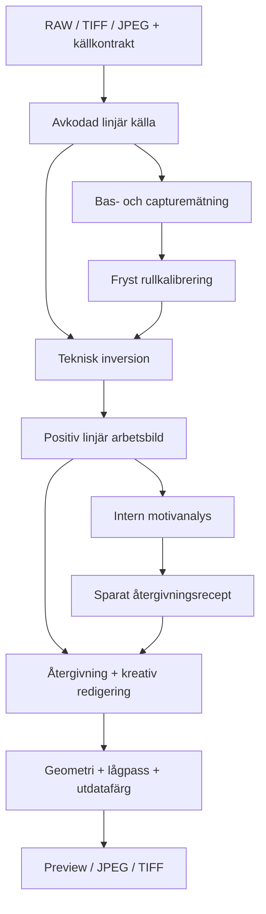

# FILMLABB 2.0 – arkitektur- och algoritmstudie

**Beslutsunderlag för separat Codex-granskning. Källgranskning: 27 oktober 2026. Slutförd rapport: 28 oktober 2026. Ingen implementation, commit eller PR.**

Studien utgår från verifierade huvudgrenar, läst källkod och två små numeriska kontroller av befintliga funktioner. Inga RAF-original, nya motorer, bildjämförelser eller prestandamätningar har framställts. Observationerna A–D i uppdraget behandlas som användarrapporterade regressionsfall; de har inte reproducerats fotografiskt här. Aktuell GitHub-main behöver inte motsvara den driftsatta version som gav referensbilderna.

Evidensmarkeringar: **[KODVERIFIERAT]** = läst aktiv kod eller angiven numerisk kontroll; **[TEORETISKT HÄRLETT]** = matematisk slutsats under uttryckliga antaganden; **[EXTERN KÄLLA]** = angiven primärkälla; **[HYPOTES]** = föreslaget beslut eller möjlig förklaring; **[KRÄVER RAF-TEST]** = fotografisk effekt/kompatibilitet som inte är fastställd. Numeriska mål nedan är föreslagna acceptansgränser, inte redan uppnådda resultat.

## 1. Beslutssammanfattning

**Rekommendation: en versionsstyrd, rullkalibrerad modell i logaritmisk relativ transmission, med fasta monotona kanalresponser, valfri referenskalibrerad korskanalskorrigering och separat, fryst automatisk positivåtergivning.** Börja med dokumenterad linjär Rec.2020-import som redan stöds. Kalla koordinaterna *effektiva densiteter*, inte uppmätta färgämnesdensiteter. Ingen motivvis automatisk anpassning av tre tekniska kanalskalor eller kanaloffsetar. [HYPOTES; F01–F08]

De fem viktigaste skälen:

1. **Basens effekt blir spårbar.** I dagens Standard kan en ny bas kompenseras exakt av en samtidigt omberäknad motivoffset. Ny bas och ny respons måste vara olika operationer. [KODVERIFIERAT; TEORETISKT HÄRLETT; kap. 4]
2. **Geometrin slutar äga färgen.** Varken kreativ crop, rotation eller en intern segmenteringsmask får ändra den tekniska modellen. Bildens automatiska återgivning analyseras separat och sparas. [HYPOTES]
3. **Inversion och bra standardbild får var sitt ansvar.** Neo använder flera aktiva färg-/tonsteg, inklusive ett automatiskt positivsteg efter SilverCore i aktuell main. Att byta logaritm eller filmbasdetektor ensamt räcker inte. [KODVERIFIERAT; N01–N10]
4. **Befintlig fungerande infrastruktur kan behållas.** Gemensam CPU-kärna, shaderparametrar, högupplöst export, geometri, Editing 2.0, projekt, teman och språk finns redan. De behöver nya kontrakt, inte en total omskrivning. [KODVERIFIERAT; F01–F15]
5. **Kunskapsluckorna går att isolera.** Ingen kan identifiera full film-/kamera-/ljuskällerespons ur en orange kant. En begränsad modell med redovisad prior och mätstatus är mer försvarbar än fem motivanpassade alternativ. [TEORETISKT HÄRLETT; R1–R4]

### Konkreta beslut

| Fråga | Beslut och begränsning |
|---|---|
| Huvudrepresentation | Linjär, uttryckligen domänmärkt källa → relativ transmission → effektiv densitet → rullrespons → positiv linjär RGB → separat återgivning. Rec.2020 är första stödda arbetsdomän. |
| RAW | Full demosaik, linjär utdata, avstängd automatisk ljusning och motiv-WB. Låst avfotograferings-WB. Dokumentera vad LibRaw faktiskt gör och vad som klippts före API-utdata. |
| Filmbas | Robust regional mätning, utan teknisk filmruta; lås mot avfotograferingssession. Ingen fabricerad ”uppmätt bas” när kant saknas. |
| Filmrespons | Gemensam konservativ prior först; uppmätta neutrala referenser får justera relativa kanalresponser. Ingen per-bild-percentil som teknisk färgkalibrering. |
| Automatisk bild | Begränsad gemensam tonplacering; försiktig färgkorrigering endast med tillräckligt referensstöd. Spara resultatet, visa status och avstå vid osäkerhet. |
| Neo-inspiration | Fristående kurvkompilering, rullgemensam analys, positivets neutralankare över ljushetsband, frysta analysrecept och filtrerad preview. Inte dess implicita färgdomän eller aggressiva defaultkorrigeringar. |
| Skärpning | Av som default i första prototypen. Neos vanliga adapter ger `sharpenAmount=0`. |
| Migration | Gammal konvertering läses i isolerad kompatibilitetsväg; explicit kopia/migration till v2, ingen tyst omräkning. |
| Första leverans | Isolerad CPU-referenskärna, syntetiska tester, basdetektor utan ram, diagnostik och lokal jämförelsevy för riktiga filer; ingen sjätte synlig motor eller UI-omskrivning. |

Detta är ett **go för avgränsad prototyp**, inte ett belägg för bättre fotografisk kvalitet. Ingen gammal motor avvecklas före lokal validering av porträttet, `_DSF8951.RAF` och en blandad filmrulle. [HYPOTES; KRÄVER RAF-TEST]

## 2. Käll- och versionsförteckning

### Kodversioner

| Projekt | Verifierad huvudgren/commit | Commitdatum | Versions-/licensstatus |
|---|---|---|---|
| FILMLABB | `main`, `c0541bd58a4d3c50b76df56e2300d2ac79ac068f` | 2026-10-27 19:38:46 CET | Beta 6-relaterade projektformat, Conversion 3 och Editing 2.0; ingen deklarerad projektlicens. README är tydlig om detta. |
| Neo / NegativeConverter | `main`, `324c2daefada7d8d8c783719f62bf7f27320349a` | 2026-10-27 03:27:10 CET | `src-tauri/tauri.conf.json`: 1.0.12; root LICENSE: MIT, copyright 2025 lex. Det är inte en verifiering av tokugai.com-deploymenten. |

Huvudgrenarna verifierades via GitHub branch-API och stämde med lokala read-only-kopior. Båda kopiorna hade tom `git status --short` efter kontrollerna. Commitdatum ovan anger källversion, inte när användarens jämförelsebilder skapades. [KODVERIFIERAT]

Källnycklarna nedan länkar till just dessa commits. Neo-sökvägar under `negative2positive/src/` förkortas ibland till `N/src/` i löptexten; FILMLABB-sökvägar anges från reporoten.

| Kod-ID | Commitlåst källa och relevant ankarpunkt | Funktioner/ansvar |
|---|---|---|
| F01 | [src/import/raw-input.js:L7](https://github.com/AxelTidehorn/negative-studio/blob/c0541bd58a4d3c50b76df56e2300d2ac79ac068f/src/import/raw-input.js#L7) | options/convert; linjär RAW, protected och wide |
| F02 | [src/calibration/color-calibration.js:L8](https://github.com/AxelTidehorn/negative-studio/blob/c0541bd58a4d3c50b76df56e2300d2ac79ac068f/src/calibration/color-calibration.js#L8) | estimate, coordinate, analyze och fitNeutral |
| F03 | [src/color/render-core.js:L16](https://github.com/AxelTidehorn/negative-studio/blob/c0541bd58a4d3c50b76df56e2300d2ac79ac068f/src/color/render-core.js#L16) | compile/technical/finish4/render/prepare; gemensam CPU-väg |
| F04 | [src/calibration/standard-controller.js:L22](https://github.com/AxelTidehorn/negative-studio/blob/c0541bd58a4d3c50b76df56e2300d2ac79ac068f/src/calibration/standard-controller.js#L22) | analyzeStandardLevels, response4 och responslås |
| F05 | [src/color/conversion3.js:L50](https://github.com/AxelTidehorn/negative-studio/blob/c0541bd58a4d3c50b76df56e2300d2ac79ac068f/src/color/conversion3.js#L50) | coordinate, analyze, compile, matrixModel och PCHIP |
| F06 | [src/calibration/frame-controller.js:L75](https://github.com/AxelTidehorn/negative-studio/blob/c0541bd58a4d3c50b76df56e2300d2ac79ac068f/src/calibration/frame-controller.js#L75) | cropChanged/import/prepareTiff; teknisk ram och källkoppling |
| F07 | [src/calibration/film-base-measurement.js:L6](https://github.com/AxelTidehorn/negative-studio/blob/c0541bd58a4d3c50b76df56e2300d2ac79ac068f/src/calibration/film-base-measurement.js#L6) | quality, measureRegions, detectSteps och refineSteps |
| F08 | [src/calibration/film-base-controller.js:L79](https://github.com/AxelTidehorn/negative-studio/blob/c0541bd58a4d3c50b76df56e2300d2ac79ac068f/src/calibration/film-base-controller.js#L79) | acceptBase2, response4-wrapper, analyzeLevels-wrapper och loupe2 |
| F09 | [src/calibration/film-base-reference.js:L5](https://github.com/AxelTidehorn/negative-studio/blob/c0541bd58a4d3c50b76df56e2300d2ac79ac068f/src/calibration/film-base-reference.js#L5) | context/compatible/valid/accept; basreferens och adaptrar |
| F10 | [src/editing/editing-engine.js:L24](https://github.com/AxelTidehorn/negative-studio/blob/c0541bd58a4d3c50b76df56e2300d2ac79ac068f/src/editing/editing-engine.js#L24) | prepare/compile/curve/gamut; Editing 2.0 |
| F11 | [src/image/image-model.js:L22](https://github.com/AxelTidehorn/negative-studio/blob/c0541bd58a4d3c50b76df56e2300d2ac79ac068f/src/image/image-model.js#L22) | pixel/sample/preview; punktreduktion |
| F12 | [src/export/presentation-sampler.js:L50](https://github.com/AxelTidehorn/negative-studio/blob/c0541bd58a4d3c50b76df56e2300d2ac79ac068f/src/export/presentation-sampler.js#L50) | plan/neighbors/pixel/tiff; interpolation och exportgeometri |
| F13 | [src/calibration/source-analysis.js:L4](https://github.com/AxelTidehorn/negative-studio/blob/c0541bd58a4d3c50b76df56e2300d2ac79ac068f/src/calibration/source-analysis.js#L4) | källanalys med återställning av preview-ägarskap |
| F14 | [src/ui/workspace-layout.js:L14](https://github.com/AxelTidehorn/negative-studio/blob/c0541bd58a4d3c50b76df56e2300d2ac79ac068f/src/ui/workspace-layout.js#L14) | arbetslayout och footer i dokumentflöde |
| F15 | [README.md:L154](https://github.com/AxelTidehorn/negative-studio/blob/c0541bd58a4d3c50b76df56e2300d2ac79ac068f/README.md#L154) | versionsstatus, arkitektur och licensbegränsningar |
| F16 | [tests/check-source-analysis.mjs:L2](https://github.com/AxelTidehorn/negative-studio/blob/c0541bd58a4d3c50b76df56e2300d2ac79ac068f/tests/check-source-analysis.mjs#L2) | befintliga testfall för källanalys/crop; tests/ innehåller övrigt harness |
| N01 | [negative2positive/src/app/rawFileLoader.js:L25](https://github.com/lexluthor0304/NegativeConverter/blob/324c2daefada7d8d8c783719f62bf7f27320349a/negative2positive/src/app/rawFileLoader.js#L25) | librawDecodeSettings/loadRawImageData |
| N02 | [negative2positive/src/pipeline/silverAdapter.js:L225](https://github.com/lexluthor0304/NegativeConverter/blob/324c2daefada7d8d8c783719f62bf7f27320349a/negative2positive/src/pipeline/silverAdapter.js#L225) | resolveSilverCoreParams/runSilverCore/filmBaseCompensationFor |
| N03 | [negative2positive/src/app/rawPostDecode.js:L84](https://github.com/lexluthor0304/NegativeConverter/blob/324c2daefada7d8d8c783719f62bf7f27320349a/negative2positive/src/app/rawPostDecode.js#L84) | packRawResult/finishRawPostDecode/computeFilmStats |
| N04 | [negative2positive/src/pipeline/filmBaseCompensation.js:L43](https://github.com/lexluthor0304/NegativeConverter/blob/324c2daefada7d8d8c783719f62bf7f27320349a/negative2positive/src/pipeline/filmBaseCompensation.js#L43) | computeFilmBaseGains/applyFilmBaseCompensationToBuffer |
| N05 | [negative2positive/src/silvercore/engine/Engine.js:L171](https://github.com/lexluthor0304/NegativeConverter/blob/324c2daefada7d8d8c783719f62bf7f27320349a/negative2positive/src/silvercore/engine/Engine.js#L171) | process/analyze/buildSettings/_applyLuts |
| N06 | [negative2positive/src/silvercore/engine/WhiteBalance.js:L90](https://github.com/lexluthor0304/NegativeConverter/blob/324c2daefada7d8d8c783719f62bf7f27320349a/negative2positive/src/silvercore/engine/WhiteBalance.js#L90) | computeAutoColor; skilj från äldre analyzeAutoWB |
| N07 | [negative2positive/src/silvercore/engine/CurveEngine.js:L651](https://github.com/lexluthor0304/NegativeConverter/blob/324c2daefada7d8d8c783719f62bf7f27320349a/negative2positive/src/silvercore/engine/CurveEngine.js#L651) | prepareSettings/computeClipPoints/generateCurves/interpolateToLUT |
| N08 | [negative2positive/src/app/main.js:L260](https://github.com/lexluthor0304/NegativeConverter/blob/324c2daefada7d8d8c783719f62bf7f27320349a/negative2positive/src/app/main.js#L260) | nybildsdefault/buildRouterSettings/processFileWithSettings/auto-WB/rescue/export |
| N09 | [negative2positive/src/pipeline/expiredRescue.js:L241](https://github.com/lexluthor0304/NegativeConverter/blob/324c2daefada7d8d8c783719f62bf7f27320349a/negative2positive/src/pipeline/expiredRescue.js#L241) | analyzeExpiredFilm/defaultExpiredRescueParams/buildExpiredRescueStages/applyExpiredTone |
| N10 | [negative2positive/src/workers/pixelAdjustments16.js:L77](https://github.com/lexluthor0304/NegativeConverter/blob/324c2daefada7d8d8c783719f62bf7f27320349a/negative2positive/src/workers/pixelAdjustments16.js#L77) | 16-bit justeringskedja med spatial rescue och färg/ton |
| N11 | [negative2positive/src/pipeline/conversionRouter.js:L11](https://github.com/lexluthor0304/NegativeConverter/blob/324c2daefada7d8d8c783719f62bf7f27320349a/negative2positive/src/pipeline/conversionRouter.js#L11) | aktiv lägesdispatch till SilverCore |
| N12 | [negative2positive/src/workers/imageEncoders.js:L66](https://github.com/lexluthor0304/NegativeConverter/blob/324c2daefada7d8d8c783719f62bf7f27320349a/negative2positive/src/workers/imageEncoders.js#L66) | selectExportSamples/encodeTiffBlob; verkligt bitdjup och ICC |
| N13 | [negative2positive/public/licenses/raw-decoder-notices.txt:L4](https://github.com/lexluthor0304/NegativeConverter/blob/324c2daefada7d8d8c783719f62bf7f27320349a/negative2positive/public/licenses/raw-decoder-notices.txt#L4) | LibRaw 0.22.1, WASM-commit och medföljande licensnotices |
| N14 | [src-tauri/vendor/libraw/src/utils/init_close_utils.cpp:L32](https://github.com/lexluthor0304/NegativeConverter/blob/324c2daefada7d8d8c783719f62bf7f27320349a/src-tauri/vendor/libraw/src/utils/init_close_utils.cpp#L32) | LibRaw-default för transfer; user_qual initialisering |
| N15 | [src-tauri/native/nc_libraw.cpp:L213](https://github.com/lexluthor0304/NegativeConverter/blob/324c2daefada7d8d8c783719f62bf7f27320349a/src-tauri/native/nc_libraw.cpp#L213) | native decodeoptions och gamma/auto-bright utdatafunktion |
| N16 | [negative2positive/src/silvercore/engine/Sharpening.js:L121](https://github.com/lexluthor0304/NegativeConverter/blob/324c2daefada7d8d8c783719f62bf7f27320349a/negative2positive/src/silvercore/engine/Sharpening.js#L121) | verklig USM-implementation; aktiv flagga avgörs i adaptern |
| N17 | [negative2positive/src/app/displayPreview.js:L280](https://github.com/lexluthor0304/NegativeConverter/blob/324c2daefada7d8d8c783719f62bf7f27320349a/negative2positive/src/app/displayPreview.js#L280) | boxnivå/filterDisplayImage och bilinjär/area-resampling |
| N18 | [negative2positive/src/app/rollAnalysis.js:L79](https://github.com/lexluthor0304/NegativeConverter/blob/324c2daefada7d8d8c783719f62bf7f27320349a/negative2positive/src/app/rollAnalysis.js#L79) | aggregateRollAnalysis/baseChromaticity/measureNegativeMean |
| N19 | [LICENSE:L1](https://github.com/lexluthor0304/NegativeConverter/blob/324c2daefada7d8d8c783719f62bf7f27320349a/LICENSE#L1) | projektlicens och copyright |
| N20 | [package-lock.json:L651](https://github.com/lexluthor0304/NegativeConverter/blob/324c2daefada7d8d8c783719f62bf7f27320349a/package-lock.json#L651) | deklarerade beroendeversioner/licenser; inte binär-SBOM |
| N21 | [negative2positive/src/silvercore/engine/Presets.js](https://github.com/lexluthor0304/NegativeConverter/blob/324c2daefada7d8d8c783719f62bf7f27320349a/negative2positive/src/silvercore/engine/Presets.js) | colorModels, toneProfiles och colorModelToToneProfile; lästa aktiva defaults |

| N22 | [negative2positive/src/app/filmBaseDetection.js](https://github.com/lexluthor0304/NegativeConverter/blob/324c2daefada7d8d8c783719f62bf7f27320349a/negative2positive/src/app/filmBaseDetection.js#L340) | autoDetectFilmBase/summarizeRegion/combineCandidates; automatisk och manuell bas |
| N23 | [negative2positive/src/app/rawResultToRgb16.js](https://github.com/lexluthor0304/NegativeConverter/blob/324c2daefada7d8d8c783719f62bf7f27320349a/negative2positive/src/app/rawResultToRgb16.js#L15) | rawResultToRgb16; bitdjup och samplelayout |

### Primärkällor och deras användning

| ID | Källa | Vad som stöds; begränsning |
|---|---|---|
| R1 | Kodak, [Basic Photographic Sensitometry Workbook](https://www.kodak.com/content/products-brochures/Film/Basic-Photographic-Sensitometry-Workbook.pdf) | Densitet mot log-exponering, bas+slöja, tå/rak del/skuldra och mask. Generell filmsensitometri; inga kurvparametrar för användarens rulle. |
| R2 | Chris Tuijn/Agfa, [Scanning Color Negatives, CIC 1996](https://library.imaging.org/admin/apis/public/api/ist/website/downloadArticle/cic/4/1/art00010) | Film+framkallning+scanner måste behandlas tillsammans; rullvariation, referenspunkter och separation av inversion/färgrymd. Inga prestandasiffror härifrån överförs till FILMLABB. |
| R3 | Gaurav Sharma, [Targetless Scanner Color Calibration, JIST 2000](https://library.imaging.org/jist/articles/44/4/art00006), DOI 10.2352/J.ImagingSci.Technol.2000.44.4.art00006 | Primärpublikationens abstract: spektral karakterisering kräver modell för medium och scanners känslighet. Fulltextens algoritm har inte reproducerats. |
| R4 | M.-C. J. Shyu, [Colorimetric characterization … using a spectral model, RIT 1994](https://repository.rit.edu/theses/4558/) | Primärpostens abstract: spektrala/transmissionsmodeller och empirisk kalibrering. Endast abstract konsulterat; dess mått återanvänds inte. |
| R5 | LibRaw, [Data Structures and Constants](https://www.libraw.org/node/31) och [upstream API-dokumentation](https://github.com/LibRaw/LibRaw/blob/master/doc/API-datastruct.html) | `output_color`, WB, demosaikval och explicit linjär gammakurva. Exakta binärdefault måste kontrolleras mot distribuerat bygge. |
| R6 | ICC, [sRGB-registret](https://registry.color.org/rgb-registry/srgb) | Primärer, D65 och styckvis sRGB-transferfunktion. Inte stöd för att sRGB-kodvärden är transmission. |
| R7 | W3C, [CSS Color 4](https://www.w3.org/TR/css-color-4/) | Färgrymdskonvertering, linjärisering och gamut som separata operationer. Inte en negativprofil. |
| R8 | Pharr, Jakob, Humphreys, [PBRT 4, Sampling Theory](https://pbr-book.org/4ed/Sampling_and_Reconstruction/Sampling_Theory) | Samplings-/rekonstruktionsfel och lågpassfiltrering före reduktion. |
| R9 | Parmar, Zhang, Zhu, [On Aliased Resizing and Surprising Subtleties in GAN Evaluation](https://arxiv.org/abs/2104.11222), 2021 | Primärartikelns abstract: filterbredd behöver följa reduktionsfaktorn; resize kan förvränga jämförelser. Ingen GAN-metodik föreslås för FILMLABB. |

Samtliga externa länkar konsulterades 2026-10-27. En föreslagen Kodak Portra-PDF-adress och LibRaws `/licensing` kunde inte öppnas via söktjänsten; inga slutsatser bygger på dessa adresser. LibRaw-licensen kontrollerades i inkluderade licenstexter/notices. [EXTERN KÄLLA; KODVERIFIERAT]

## 3. Neos automatiska RAF→export-kedja

### 3.1 Vilken körväg granskas?

En ny färgnegativfil i aktuell webb-main, utan sparat recept, namngiven filmpreset, manuella reglage eller explicit `?rescueDefault=off`. Importens automatiska filmklassificering kan ge annan gren för positiv/SV; här villkoras analysen på att filen behandlas som färgnegativ. Återställda sessioner och tidigare användarval kan ändra defaults. Koden i `pipeline/oracle/` är referens/testkod och används inte som bevis för aktiv normalväg. [KODVERIFIERAT; N01, N02, N08]

**Anropsordning:** `main.js` filinläsning → `rawFileLoader.librawDecodeSettings/loadRawImageData` → LibRaw → `rawPostDecode` → `createDefaultSettings` och ram/geometri → `buildRouterSettings` → `convertFrameWithRouter` → `convertColorWithSilverCore/runSilverCore` → förbehandling → `Engine.analyze/buildSettings` → `generateCurves` → `_applyLuts` → positivets automatiska rescueanalys → adjustmentsteget → exportkodning. Analysreferensen kan vara en separat bild i källkoordinater. Sparade recept använder befintliga värden och hoppar över vissa mätningar. [KODVERIFIERAT; N01–N12]

### 3.2 Avkodning, domän och mätning

| Aktiv funktion | Input → output / default | Matematik och styrning | Risk och relevans |
|---|---|---|---|
| `rawFileLoader.librawDecodeSettings` | RAF → demosaikad RGB16; `noInterpolation:false`, `useAutoWb:true`, `useCameraWb:true`, `useCameraMatrix:3`, `outputColor:1`, normalt 16 bit; ibland halvupplöst första import | LibRaw sköter CFA/X-Trans, WB och kamera→sRGB-primärer. `gamm`, `noAutoBright`, `userQual` sätts inte här. | Ange inte ”linjär sRGB” utifrån primärvalet. Kommentaren ”AHD” bevisar inte AHD på Fuji X-Trans. |
| `rawResultToRgb16`, `packRawResult`, `finishRawPostDecode` | 8/16-bit utdata → RGBA16 plus 8-bit spegel | 8 bit multipliceras med 257; sensorfel kan undertryckas, felaktig demosaikbild avvisas; filmstatistik mäts vid behov. | 16-bit behållare bevisar inte 16 bit verklig information. Ingen allmän kornreduktion visas av sensorfelslagningen. |
| `createDefaultSettings` | Ny bild → recept | `coreColorModel:'standard'`, preset/profile/paper `'none'`, pre/post-saturation 100, borderbuffer 10, WB-läge `'auto'`, reglage 0. **`expiredEnabled:RESCUE_DEFAULT_ON`**, där flaggan är på om URL inte explicit stänger av. | Bibliotekets `EXPIRED_RESCUE_DEFAULTS.expiredEnabled=false` är inte appens faktiska nybildsdefault. |
| `autoDetectFilmBase` | RGBA16 när tillgänglig → RGB16/RGB8-bas med metod/heuristisk confidence | Kantprover på flera positioner; vid inget borderhint också inre rutnät. Trimmed mean 10 %, spridning, orangebias, klippning. Väljer 3–9 bland toppkandidater. | Om orange-eligible saknas används ändå rankade kandidater. Detta är inte säker abstention; motivfärg kan bli bas. |
| `filmBaseCompensationFor` / `_preprocessBuffer` | Originalets kodvärden → flat-field-korrigerad och basmultiplicerad RGBA16 | Färgnegativ: `g_c=clip((G/B_c)^s,.25,4)` där `G=(B_R B_G B_B)^(1/3)` för default `'density'`, `s=1`. `'linear'` använder aritmetiskt medel. Värden avrundas/klipps efter multiplikation. | Namnet ”density” gör inte pixelkedjan till log-densitetsinversion. Operationen sker på importerade kodvärden. Låna struktur, inte implicit fysik. |

[KODVERIFIERAT; N01–N04, N08, N13, N22–N23]

**Transferfunktionen är en uttrycklig verifieringsgräns.** Appen begär sRGB-primärer men sätter inte gammakurvan. Det inkluderade native LibRaw-källträdet initierar `gamm={.45,4.5,…}`; native bryggan sätter inte om det, och utdatafunktionen använder gamma-/ljusningslogik. Det talar för icke-linjär LibRaw-utdata, inte för explicit IEC-sRGB-transfer. WASM-byggesnoticen anger LibRaw 0.22.1, men en numerisk ramp genom just distribuerad WASM har inte körts här. Därför är *sRGB-primärer med ärvda utvecklingsdefault* korrekt beskrivning; exakt transfer, ljusning och X-Trans-demosaik kräver avkodningsdiagnostik. [KODVERIFIERAT; HYPOTES; N13–N15; R5]

### 3.3 SilverCore: vad gör inversionen egentligen?

`Engine.analyze` kör pre-saturation (identitet vid 100), hämtar histogramdata eller rullens `analysisOverride` och beräknar `computeAutoColor`. `ImageProcessor.analyzeImage` använder 256 histogramfack över 16-bitvärden (`v >>> 8`), inom separat analysregion eller ett 10 % inset. Mörk/ljusgränser har ett facks säkerhetsutvidgning och skalas tillbaka med 257. [KODVERIFIERAT; N05–N07]

En viktig faktisk fallback: appens `colorModel='standard'` finns **inte** som nyckel i `colorModels`. Både analys och `Engine.buildSettings` faller tillbaka på `basic`, medan `colorModelToToneProfile.standard` väljer tonprofilen `standard`. Effektivt används histogramtrösklar **0,2 % vid negativets ljusa ände och 0,1 % vid mörka änden**, och `basic` har blå HSL-huejustering **−10** vid profilstyrka 100. Detta verifierades även genom anrop av befintliga `resolveSilverCoreParams` och `Engine.buildSettings`. [KODVERIFIERAT; N02, N05–N07, N21]

För kanalmedelpunkterna `m_c` i histogramnormaliserad, inverterad koordinat:

\[
\bar m=(m_R+m_G+m_B)/3,\qquad correction_c=round(100(m_c-\bar m)).
\]

R/G/B-korrektionerna går till cyan/tint/temp. De är motivstatistiska, inte uppmätt ljuskälla. Default `autoColorLevel=100` i adaptern ger styrka 1 i motorn. `wbMode='auto'` blir en okänd metod i `colorLinearLayer` och går till dess `linearFixed`-default; det är inte en dold generell auto-WB-modul där. [KODVERIFIERAT; N02, N06, N07]

`generateCurves` bygger ett normaliserat rutnät, lägger råkoordinaterna mellan kanalvisa histogramgränser och formar utvärden genom färg-, exponerings-, gamma-, kontrast-, skugg-/högdager- och soft-clip-lager. Standardprofilen innehåller auto-tone, kontrast +10, blacks +2 och whites −2 redan när användarreglagen står på noll. Auto-tone använder:

\[
\gamma_a=clip\left(\frac{1}{\log_{0.5}(\bar m)},0.8,1.1\right),
\]

och sätts in som invers gammafaktor i `prepareSettings`. Kontrast använder normaliserad tanh/atanh-formning. Negativinversionen görs genom omvänd utkurva (`invertCurve`); `interpolateToLUT` bygger tre linjärt interpolerade LUT:ar med 65 536 poster. Detta är **histogramförankrad kurvinversion**, inte `-log10(I/B)` följt av en identifierad filmkurva. [KODVERIFIERAT; N07]

Ordningen efter LUT är HSL-korrigering → valfri 3D-LUT → saturation → valfritt papper → villkorad skärpning. Default enhancedProfile/paper är `none`, saturation 100. 3D-profilerna är därför inte en generell förklaring till normalresultatet. [KODVERIFIERAT; N05]

### 3.4 Den aktiva automatiska positivkorrigeringen

**Detta steg är avgörande för en rättvis Neo-jämförelse.** Nybildsdefault aktiverar rescue i appen. `maybeAnalyzeExpiredRescue` mäter den konverterade positiva bilden, lagrar analysen och återanvänder den över vanliga kärnreglage. Mätningen kan räknas om vid ny källa/crop/filmtolkning. Export av en tidigare oöppnad bild mäter motsvarande analys via `applyFrameExpiredAnalysis`. `frameWantsAutoWhiteBalance` kräver `!expiredEnabled`; den separata automatiska gråpunktsvägen är därför normalt avstängd när rescue är på. [KODVERIFIERAT; N08–N10]

`analyzeExpiredFilm` använder upp till cirka 200 000 prov, minst 400, ett 1024-facks luminanshistogram, 0,5/99,5-percentiler och åtta ljushetsband med kanter `[0,.06,.15,.3,.45,.6,.75,.9,1.0001]`. Nästan neutrala prover viktas; tre mean-shift-iterationer med klusterradie 0,06 söker bandens tätare färgpopulation. Ett band behöver vikt ≥8 och andel ≥0,004. Varje bands medelfärg jämförs med dess viktade luminans. [KODVERIFIERAT; N09]

Förenklad beskrivning av dess färgsteg:

\[
o_c(Y)\approx-\{n\,lean_c+x[lean_c(Y)-lean_c]\},\quad
p'_c=clip(p_c+o_c(Y)).
\]

`n` är neutralisering och `x` crossover-styrka; båda default 100 %. Offsetankare interpoleras formbevarande över ljushet och begränsas med `BAND_MOVE_LIMIT=.35`. Sedan används en gemensam 256-posters tonkurva med interpolerad läsning, nivåer, gamma och tanh-kontrast. Startparametrarna löser gamma mot **kodvärdesmedian 0,42**, brightness begränsad −25…60 och contrast 10…45. Det är en praktisk återgivningsheuristik, inte rekonstruktion av scenljus. Gemensam kurva per kanal är inte samma sak som luminansskalning och garanterar inte bevarad färgkvot. [KODVERIFIERAT; N09, N10]

Spatial rescue kan dessutom mäta en begränsad kvadratisk slöjyta via OpenCV-vägen; ojämn-slöjestyrka default 100, lokal kontrast default 0. Det finns därmed ett asynkront extra återgivningssteg när en giltig spatial analys blir tillgänglig. Det måste skiljas från vanlig skärpning och från ren kurvinversion vid lokala jämförelser. Exakt aktivering och utfall för användarens porträtt är okänt. [KODVERIFIERAT; KRÄVER RAF-TEST; N08–N10]

### 3.5 Skärpning, preview, export och rulle

**Unsharp Mask är inte aktiv i den vanliga adapterkedjan.** `Engine` har en verklig implementation och en gren `sharpenAmount>0`, med radiusdefault 1 och thresholddefault 0. Men `resolveSilverCoreParams` returnerar inte skärpningsfälten. `Engine.buildSettings` får då amount 0. En numerisk kontroll med inkommande `{sharpenAmount:1}` gav fortfarande `adapterForwardsSharpen=false`, `engineSharpen=0`. Bandexportens skärpningsgren får samma motorinställningar. Detta utesluter inte separat kod i en annan version, men aktuell defaultkedja stöder inte förklaringen ”Neo skärper automatiskt med USM”. [KODVERIFIERAT; N02, N05, N16]

Preview har en kvarhållen boxmedlad nivå och därefter bilinjär/area-resampling beroende på skalfaktor (`displayPreview.js`). SilverCore-analys kan hämtas från separat källreferens så att viewport inte skapar nya kurvor. CPU16 producerar slutliga/exporterade pixlar; interaktiv GPU kör motsvarande steg men är inte bevis för pixelidentitet i alla kvalitetslägen. [KODVERIFIERAT; N02, N11, N17]

Export återanvänder bildens recept, konverterar vid full upplösning, applicerar adjustment-/rescuesteget i 16-bitvägen och kodar TIFF/JPEG. `imageEncoders.encodeTiffBlob` väljer verklig RGBA16 när den finns och skriver ICC-taggen 34675 med inkluderad sRGB-profil. Annars kan en 16-bitfil bära endast uppskalade 8-bitvärden; hjälpfunktionen gör skillnaden explicit. JPEG går via bild/canvas-kodning; en allmän garanti om inbäddad ICC i alla JPEG-fallbacks är inte fastställd här. Profilmärkning löser inte automatiskt en tidigare transferfunktionsavvikelse. [KODVERIFIERAT; N08, N10, N12]

`rollAnalysis.aggregateRollAnalysis` beräknar viktad medianbas, markerar basfärgs-/densitetsavvikare och samlar kanalgränser från 20/80-percentiler över rullen samt medianmedelpunkt. `buildCoreConversionSettings` skickar `rollFrame.channelData` som override bara när rullposten är låst; per-bildexponering läggs separat. Utan detta sker motivvis histogramanalys. Rescue är fortfarande en separat per-bildåtergivning och innebär att rullåsning inte automatiskt fryser hela slututseendet. [KODVERIFIERAT; N08, N18]

### 3.6 Vad ska inspirera – och vad ska undvikas?

| Prioritet | Princip att inspireras av | Skäl |
|---|---|---|
| 1 | Fristående positivanalys efter invertering, med ljushetsberoende färgankare | Kan adressera färgstick/crossover som en basmätning inte löser. Kräver försiktigare confidence och styrka än Neos default. |
| 2 | Fryst, serialiserbar analysreferens och rullgemensam respons | Reglage/viewport ska inte återskapa teknisk respons. |
| 3 | Kurvor kompilerade till LUT och uttrycklig ordning | Ger mätbar CPU-väg och effektiv preview utan flera motorer. |
| 4 | Gemensamma tonoperationer, mjuka ändar och gränssatt auto-tone | Bra återgivning kräver mer än kanalvis nivåsträckning. |
| 5 | Box-/area-filtrerad preview och fullprecisionsplan hela exportvägen | Gör detaljjämförelsen mer rättvis och minskar aliasing. |

[KODVERIFIERAT; HYPOTES; N02, N05–N12, N17–N18]

**Kopiera uttryckligen inte:** implicita LibRaw-transferdefault; gainklippning före analys; antagandet att bästa orange kandidat alltid är bas; motivvis trekanalssträckning som rullkalibrering; ”standard”-nyckelns fallbackberoende; fasta −10 blå hue som osynlig teknisk korrektion; nästan-neutral=verkligt neutral; rescue på maximal färgstyrka utan bildspecifik tillförlitlighetsgräns; stor spatial slöjkorrigering som standard för all film. Flytta inte heller över hela Neos globala tillstånds- och cachekomplexitet. [KODVERIFIERAT; HYPOTES]

## 4. FILMLABB:s pipeline och rotorsaker

### 4.1 Aktuellt, delvis klart och saknat

| Område | Verifierat tillstånd i main | Konsekvens |
|---|---|---|
| Källimport | Linjär RAW; protected via Rec.2020→sRGB med gemensam halvskala; wide som Float32 Rec.2020; TIFF ICC-/kodningshantering finns | Bygg vidare på explicit domänmärkning. Protected klipper negativa transformerade kanaler och kan inte återställa LibRaw-klippning. |
| Fem val | Original=`log39`, Standard=`calibrated4`, Curve/Density/Matrix=`*3`; äldre grenar finns kvar | Det är fem användarval med delad analys/nedströmskedja, inte fem oberoende färgkalibreringar. |
| Respons/ton | Standard har persistent respons och separat gemensam tonanalys | Delvis rätt separation; den initiala responsen kommer fortfarande från motivpercentiler. |
| Filmbas 2 | Regional median/MAD/klippning, flera kandidater, manuell flyttbar provyta, 8× negativlupp, preview/accept/undo, lås och rullsession finns | Återskapa inte dessa funktioner. Koppla loss mätningens kontrakt från responsadaptrarna och filmrutan. |
| Analys | `source-analysis.js` använder full källa för nya standard-/conversionprojekt med `analysisSampling='source'` | Tidigare previewupplösningsberoende är delvis åtgärdat. ROI-beroendet kvarstår. |
| Rendering | `NSPixelKernel` gemensam CPU-väg, GPU-motsvarighet; snapshotstyrd export | Återanvänd ryggraden men inför ny kärnmodell. |
| Kreativa reglage | Editing 2.0 finns med monoton PCHIP-tonkurva, OKLab-mättnad och gamutbegränsning | Förslaget är inte att bygga ”bättre reglage” från noll. Adapter efter tidigare klippt positiv behöver ändras. |
| Geometri/UI | Separat geometri och komposition, rotationsexport, arbetslayout, teman, språk och footer finns | Ingen stor UI-omskrivning behövs. Bevara faktisk aktuell layout. |

[KODVERIFIERAT; F01–F15]

### 4.2 Exakt härledning: när tar basen ut sig?

`color-calibration.estimate` mäter `s.lo_c` och `s.spans_c` från `-log10(I_c)` i filmrutan. Med bas `B`, ljusgain `L` skapas:

\[
o_c=s.lo_c+\log_{10}(B_c/L_c),\quad h_c=s.spans_c.
\]

Standardens tekniska pixelsteg är:

\[
u_c=\frac{-\log_{10}(\max(\epsilon,I_c)L_c/B_c)-o_c}{h_c}
=\frac{-\log_{10}(\max(\epsilon,I_c))-s.lo_c}{h_c}.
\]

**Bas och ljusgain försvinner exakt när samma värden används i ny responsuppskattning och konvertering.** Detta gäller före efterföljande klippning och för giltiga positiva parametrar. Det är inte bevis för att basen alltid saknar verkan: om responsen hålls fast och en ny bas tillförs återstår `log10(B_new/B_old)/h_c`. [KODVERIFIERAT; TEORETISKT HÄRLETT; F02, F03]

Den numeriska kontrollen använde befintliga `NSColorCalibration.estimate/coordinate` på en syntetisk 100×100 Float32-bild, inga nya motorfunktioner. Pixel `[.18,.08,.025]`, bas A `[.75,.45,.22]`, bas B `[.9,.35,.3]`:

| Kontroll | Resultat |
|---|---|
| Ny bas + ny respons från samma ROI | A `[.4223762138,.6184245022,.6592537963]`; B samma inom `5.56×10^-17` |
| Fryst A-respons + bas B | `[.4990032272,.4893288894,.7695528784]` |
| Skillnad vid fryst respons | `[+.0766270134,−.1290956128,+.1102990821]` |

[KODVERIFIERAT; TEORETISKT HÄRLETT]

**Filmbas 2 kräver nyansering.** `acceptBase2` fryser både bas och respons/adaptrar. Vid första godkännande skapas responsen med den nya basen: kompensationen ovan kan alltså redan vara inbakad. Om en tidigare respons är låst behålls den när basen byts, vilket i Standard kan ge verklig baseffekt. För Curve/Density/Matrix använder däremot `NSConversion3.coordinate(...,auto=true)` uttryckligen endast `reference.lo/spans`; `reference.base` läses först i vägen utan autonivåer. De motorerna kan därför ignorera en uppdaterad bas under den automatiska koordinatvägen även med adapterlås. [KODVERIFIERAT; F04, F05]

Det går därför inte att säga ”manuell bas misslyckades” om porträttet. Uppdraget anger att båda porträttversionerna hade manuell bas och att vanliga reglage förbättrade resultatet. Koden visar flera sätt basen kan neutraliseras eller ha begränsad uppgift; exakt sparat recept och version avgör vilken väg som användes. [KODVERIFIERAT; HYPOTES; KRÄVER RAF-TEST]

### 4.3 Varför kan filmrutan ge stora hopp?

`frame-controller.cropChanged` anropar `updateBase()` och `analyzeLevels()`. Utan giltig fryst respons beräknar `analyzeStandardLevels` nya kanaloffsetar och spans från `cropRegion`. Även med giltig låst respons kör `CC4.analyze` ny luminansstatistik i ROI: 1,5/98,5-percentiler och gemensam span ≥0,15. Tonplaceringen kan därför ändras kraftigt när ramen inkluderar bas/hållare/extremer. [KODVERIFIERAT; F02, F04, F06]

I syntetiska kontrollen ändrade ROI från hela bilden till `{x:.15,y:.15,w:.65,h:.65}` responsens spans från `[1.03333,.84545,1.22121]` till `[.66667,.54545,.78788]` och offsetar från `[.18333,.22727,.13939]` till `[.33889,.35455,.32323]`. Detta visar faktisk kodkänslighet för motivurval, inte storleken på felet i `_DSF8951.RAF`. [KODVERIFIERAT]

Med låst respons är den gemensamma tontransformen före klippning mindre färgförändrande än tre fria kanalskalor. Men att dra bort samma offset från R/G/B bevarar inte kanalkvoter; klippning, färgmättnad och skuldra kan förstärka färgskillnaden. Kall/varm förskjutning får därför inte automatiskt tillskrivas omräknad respons i ett projekt där Filmbas 2 faktiskt höll den låst. [TEORETISKT HÄRLETT; KRÄVER RAF-TEST]

### 4.4 Rangordnade förklaringar till porträttskillnaden

| Rang | Möjlig orsak | Belägg och återstående kontroll |
|---|---|---|
| 1 | Olika automatisk positivåtergivning, inklusive Neos rescue | Aktiv i aktuell Neo-default; FILMLABB har annan grundton/färgkedja. Kontrollera driftsatt version och rescue on/off på samma fil. |
| 2 | Motivbaserade kanaloffsetar/spans och gemensam ROI-tonplacering i FILMLABB | Direkt kodbelagt och numeriskt demonstrerat; separera responslåst/olåst fall. |
| 3 | Olika RAW-utveckling: WB, matris, transfer, auto-bright och klippning | Tydligt olika begärda inställningar. Jämför samma linjära TIFF för att isolera motorn. |
| 4 | För tidig kanal-/gamutklippning och generiska responspriorer | Kodvägar finns; verklig omfattning kräver kanalstatistik och bilder. |
| 5 | Resampling och visningsskala | FILMLABB punktreducerar, Neo använder filtrerad nivå. Kan ändra upplevd detalj och korn. |
| 6 | Demosaik och explicit skärpning | Olika decoderbyggen är möjliga bidrag; USM är av i granskad normaladapter. Ingen slutsats om verklig detaljvinst. |

[KODVERIFIERAT; HYPOTES; KRÄVER RAF-TEST]

Att de fem motorerna upplevs lika är rimligt eftersom de delar motivnormalisering och stora delar av nedströmsrenderingen. Curve/Density/Matrix har avsiktligt begränsade priorer och matrisavvikelse. Ingen teori säger att de därför måste ge synligt bättre porträtt. [KODVERIFIERAT; HYPOTES; F03, F05]

## 5. Matematiska kandidater och val av en modell

### 5.1 Jämförelse och bortval

| Modell | Fördel | Avgörande problem | Beslut |
|---|---|---|---|
| Direkt `1-I/B` + kanalnivåer | Enkel och snabb, nära en kurvbaserad användarmodell | Ingen explicit filmrespons; teknisk färg blir lätt motivnormalisering | Inte huvudmodell. Neo-kurvor används som referens, inte motorval. |
| Effektiv densitet + fasta monotona responskurvor + begränsad matris | Tydlig bas, respons, referenser och diagnos; LUT-kompilerbar | Kräver domänspecifika priorer och verklig kalibrering för hög färgnoggrannhet | **Vald huvudmodell.** |
| Full spektral inversion av färgämnen/ljuskälla/kamera | Starkare fysisk modell med rätt mätdata | Spektra och identifierbarhet saknas; illabestämt från en enda bild | Utanför scope, ingen automatisk ”spektral” approximation. |

[TEORETISKT HÄRLETT; HYPOTES; R1–R4]

### 5.2 Källrepresentation och ordning

Första stödda domän är **linjär Rec.2020 D65** från dokumenterad RAW-utveckling eller uttryckligt märkt TIFF. Detta väljs för att FILMLABB redan har en sådan Float32-väg och för att undvika dess protected-vägs efterföljande sRGB-klippning. Rec.2020 är inte ett fysikaliskt färgämnesrum; logaritmen blir en *effektiv* domän. Kamera→Rec.2020 görs av dekodern med frysta inställningar före logaritmen. Kreativ scen-WB görs efter teknisk invertering och får inte ändra decoderreceptet. [KODVERIFIERAT; HYPOTES; F01]

Kamera-RGB före källmatris är den enda alternativa källdomän som ska jämföras, i ett begränsat experiment. Den kan undvika negativa blandade kanaler före logaritmen men behöver separat kamera-/ljuskälle-/filmprofil för att ge positiv colorimetrisk RGB. Att använda kamerans vanliga positiva matris efter log-inversion är inte automatiskt korrekt. Ingen av vägarna får dela responsparametrar utan profilkonvertering. [TEORETISKT HÄRLETT]

**Experiment med högst två kandidater:** A=linjär Rec.2020 enligt beslutet; B=demosaikad native kamera-RGB med explicit black/scaling/WB-kontrakt. Använd samma RAF, samma demosaik och samma basregion, tre neutrala steg samt färgreferens där tillgänglig. Mät klippning, neutralrampens crossover, referensfärgfel och bildpreferens. B ersätter A först om den inte ökar neutralfel eller instabilitet, minskar p95 ΔE00 med minst 10 % på en giltig hållen-utanför-kalibreringen färgreferens och inte försämrar porträtt/natt i strukturerad bedömning. Utan tillförlitlig färgreferens avgör inte ett ensamt ΔE-tal; A kvarstår provisoriskt. Detta jämför **importdomän inom samma motor**, inte två synliga motorer. [HYPOTES; KRÄVER RAF-TEST]

### 5.3 Transmission, bas och ljus

Låt `J_c(x)` vara källa efter dokumenterad black-subtraktion, decoder/WB och eventuell flat-field. Låt `B_c` vara uppmätt oexponerad film i samma domän och med kompatibel skala:

\[
T_c(x)=\frac{J_c(x)}{B_c},\qquad d_c(x)=-\log_{10}(\max(\epsilon_c,T_c(x))).
\]

Värden `T>1` ger negativa effektiva densiteter; behåll dem som diagnostiskt relevanta värden och klipp inte till 1 före respons. `J≤0` eller otillräcklig signal måste markeras, inte förvandlas till säkra färgprover. Epsilon sätts ur dokumenterad numerisk/noise-floor-prior i källdomänen och märks som prior om ingen brusmätning finns. Det får inte automatiskt vara `1/65535` bara för att en senare fil har 16 bit. [TEORETISKT HÄRLETT; HYPOTES]

Med separat tom ljusreferens `W` kan först `U=J/W`, `b=B/W` bildas; då `T=U/b=J/B`. Man ska **inte** applicera samma ljusgain ännu en gång efter basdivision. Flat-field avser spatial variation; en genomsnittlig RGB-ljuskällereferens är en annan sak. Bas+slöja och orange mask ingår i referensen men division avlägsnar inte automatiskt täthetsberoende färgkorskoppling. [TEORETISKT HÄRLETT]

Skanningsexponering som multiplicerar både `J` och `B` med samma positiva `k` ska ta ut sig. Om lånad rullbas togs vid annan exponering måste känd gemensam skalfaktor först appliceras. ISO- eller WB-ändring, kanalvis klippning och ändrad ljuskällespektrum är inte garanterat en sådan gemensam skala. [TEORETISKT HÄRLETT]

### 5.4 Respons och positiv RGB

Använd tre monotona funktioner `f_c` från effektiv densitet till log-positiv koordinat. Grundformen är en gemensam linjär prior, med möjlighet till uppmätta monotona splinekurvor. En begränsad matris verkar därefter i denna logdomän:

\[
v_c=f_c(d_c),\quad \ell=Mv+a,\quad P_c=0.18\,10^{\ell_c}.
\]

`P` är en uppskattad positiv linjär RGB-representation i profilen/arbetsrummets angivna primärer, **inte en återvunnen absolut scenradiometri**. Default `M=I`; `a` är fryst referensoffset, inte motivets kanalpercentiler. Referensluminansens absolutnivå är ett gaugeval: sätt den en gång vid profilskapande, och lägg senare bildexponering i återgivningsreceptet. [TEORETISKT HÄRLETT; HYPOTES]

En uttrycklig startprior för prototypens färgnegativ kan vara `f_c(d)=(d-1)/.65` i alla kanaler. Värdena 1 och .65 är **provisorisk positions-/lutningsprior**, inte uppmätt filmsensitometri eller universell filmprofil. Priorstatus måste följa exportdiagnostiken. Standardbildens exponering kompenseras gemensamt, utan att skapa tre nya filmkurvor. [HYPOTES; KRÄVER RAF-TEST]

Toe och shoulder i filmens respons kan göra exakt invers brant/instabil. Kalibrerade `f_c` får därför begränsad derivata och mjuk extrapolering utanför referensomfånget; ingen påstådd rekonstruktion av redan mättad filmsignal. Monoton PCHIP finns redan i projektet, men koefficienter och validering behöver ett nytt responskontrakt. Ett generiskt kreativt S-utseende ska ligga i återgivningen, inte döljas som uppmätt filmrespons. [TEORETISKT HÄRLETT; KODVERIFIERAT; F05, F10]

### 5.5 Vad kan identifieras?

| Tillgänglig information | Vad som får bestämmas | Vad som inte kan bestämmas |
|---|---|---|
| Oexponerad kant | RGB-bas+slöja i aktuell kedja, spridning och klippning | Tre filmgamman, full korskanalsmatris, originalscenens WB |
| Tom ljuspad | Spatial flat-field och referenssignal under samma captureförhållanden | Filmens karaktäristiska kurvor eller scenbelysning |
| Två kända neutrala ytor | Relativa kanaloffsetar/lutningar över provat intervall efter gaugefixering | Toe/shoulder utanför intervallet eller allmän 3×3-färgkarakterisering |
| Flera uppmätta neutrala steg | Monotona kanalresponser med begränsad extrapolering | Full korrigering av mättade färger |
| Filmfotograferat färgkort med giltig referens | Regulariserad domänspecifik matris/respons, utvärderad på andra rutor | Universell kamera-/ljuskälleoberoende profil |
| Blandad rulle utan referens | Robust statistik för stabil återgivningsprior och avvikarvarning | Unik sann filmkurva eller entydig separation av motivdominans och färgstick |
| En bild utan kant | Endast heuristisk återgivning och markerad kalibreringsbrist | Uppmätt filmbas eller fysiskt bestämd teknisk färg |

[TEORETISKT HÄRLETT; HYPOTES]

För uppmätt matris: minimera robust referensresidual plus `λ‖M−I‖²`, `λ_s‖f−f_prior‖²` och kurvkrökning. Fixera neutralaxel (`M·1=1`) och gemensam exponeringsgauge; sätt initialt `‖M−I‖₂≤.15` och konditionstal ≤2. Dessa gränser ska inte kringgås för att passa en dålig referens. Håll en del färgprover utanför fit; förkasta om förbättringen saknas där. Neutrala prover räcker endast till diagonal/relativ responsfit, inte fri matris. [HYPOTES]

### 5.6 Spektral begränsning

En förenklad kameraavläsning är

\[
J_c\propto\int S_c(\lambda)E(\lambda)\tau_{base}(\lambda)
10^{-\sum_j q_j a_j(\lambda)}d\lambda+flare_c.
\]

Här är `S` sensorns spektrala känslighet, `E` ljuskälla, `a_j` färgämnens absorption och `q_j` mängd. Logaritmen av en integral är inte integralen av logaritmen. Kamerakanalernas log-RGB är därför inte tre oberoende mätningar av cyan/magenta/gul-densitet. Flare är dessutom additiv och tar inte ut sig genom basdivision. [TEORETISKT HÄRLETT; EXTERN KÄLLA; R3–R4]

Praktiskt löfte: bättre stabilitet, observerbar kalibrering och validerad återgivning för en dokumenterad film-/capturedomän. Inte spektral korrekthet, perfekt originalscen eller universell färgmatchning efter byte av ljuspad. [HYPOTES]

## 6. Filmbas utan teknisk filmruta

### 6.1 Nytt kontrakt, återanvänd mätning

Filmbas 2:s median, MAD, relativ 5–95-spridning, klippnings-/mörkandel, källkoordinatsprov och 8×-lupp är användbara. Dess `candidate/detectSteps/refineSteps` tar däremot en ram, använder innanför/utanför och jämför mot motivets övre percentiler. Det måste ersättas med ramoberoende kandidatgenerering och explicit evidens för **oexponerad film**, inte bara homogen yta. [KODVERIFIERAT; F07–F09]

Föreslaget API, utan implementation:

```text
measureBase(source, captureContext, regionSet) -> BaseMeasurement
findBase(source, captureContext, detectorVersion) -> BaseProposal
acceptBase(proposal, expectedRevision) -> BaseReference
checkBaseCompatibility(reference, captureContext) -> compatible | needsScale | invalid
```

`BaseMeasurement` innehåller domän-id, källrevision, regionlista, medianRGB, MADRGB, relativ spridning, sampleCount och effektivt antal spatiala provblock, kanalvis clipped/dark fraction, flat-field-version, rejectionReasons. `BaseProposal` separerar mätkvalitet från sannolik regionklass; `BaseReference` har provenance, acceptance, rull/session-id, skala och versionshash. Ingen respons eller historisk motoradapter får ligga inne i basreferensen. [HYPOTES]

### 6.2 Detektionsalgoritm

1. Sök flera remsbredder i bildens periferi och inre smala sammanhängande korridorer. Använd lågupplöst proxy endast för lokalisering; slutmät originalets linjära pixlar. Ingen kreativ crop behövs.
2. Dela remsor i små fält och testa homogenitet, signal, klippning och stöd i flera spatialt åtskilda regioner. Gruppera liknande **RGB-vektorer**, aldrig tre separata maxima från olika platser.
3. Leta kant-/remsgeometri som skiljer film från belyst pad/perforering och mörk hållare. Orangebias är mjuk information för färgnegativ, inte universellt krav för SV eller alla ljuskällor.
4. Avvisa text/damm med lokala residualer och robust statistik. Breda ljusa neutralytor eller helt genomlysta hål kräver extra stöd; reflexer/klippta kanter avvisas.
5. Mät bästa regiongruppen på nytt i full källa. Motstridiga basfärger, otillräcklig topologi eller utebliven kant ger `review/missing`, aldrig en automatisk standardorange.

[HYPOTES]

Startgränser att kalibrera: ≥256 giltiga prov över ≥8 spatiala block, minst två åtskilda stödområden för automatisk acceptans; clipped <0,1 % per kanal, låg signal <0,5 %, normaliserad MAD <1,5 %, relativ 5–95-spridning <6 %. Bestäm mörkgräns från källdomän/noisestatus. Smala remsor kan vara användbara med färre oberoende prov men ska då ge review. **Ingen confidence får presenteras som kalibrerad sannolikhet** innan detektorutfall mätts på märkta bilder. [HYPOTES; KRÄVER RAF-TEST]

### 6.3 Manuell fallback och saknad kant

Behåll ett enda basverktyg: visa negativet, rita/flytta/ändra godtycklig rektangulär provyta, 8×-lupp, live linjär RGB/MAD/klippning och tydlig provstatus. Preview jämför mot aktiv/automatisk referens, Accept skapar nytt bas-id, Undo återställer föregående id, Reset återgår till det automatiska förslaget. Touch/Pencil ska kunna flytta hörn utan att växla till kompositionscrop. Ingen teknisk filmruta krävs eller visas i flödet. Det mesta av verktygsdelen finns redan; bildprov ska förbli samma källa och domän som motorn. [KODVERIFIERAT; HYPOTES; F08]

När kant saknas: 1) använd låst kompatibel rullreferens; 2) annars manuell mätning på ett annat negativ i samma capture-session; 3) annars markerat **okalibrerat** läge med explicit domänspecifik prior. En antagen bas får inte sparas som measured och får inte senare oavsiktligt ersätta en riktig referens. Exakt färgkorrekt automatiskt resultat utan tillräcklig information kan inte garanteras. [TEORETISKT HÄRLETT; HYPOTES]

Referensen ogiltigförklaras vid ändrad dekoder/utdatafärgrymd/transfer, ändrad WB eller okänd gain, ändrad flat-field/ljuskällespektrum, annan film-/framkallningssession eller klippt ny capture. En känd gemensam exponeringsskala kan konverteras med spårbar faktor. Automatisk byte av bas på varje bild är förbjudet när rullreferensen är låst. [HYPOTES]

## 7. Filmrespons, färg och automatisk positivåtergivning

### 7.1 Parameterägarskap och intern analys

| Ägare/livstid | Parametrar | Vad kan utlösa omräkning? |
|---|---|---|
| Capture-session | RAW-inställningar, källprofil, WB, ljus/flat-field, skala/noise-prior | Explicit import-/captureändring, med inkompatibilitetskontroll |
| Filmrulle/profil | Basreferens, `f_c`, `M`, referensoffset/gauge och mätstatus | Godkänd ny bas eller explicit referenskalibrering; ingen crop |
| Bild, teknisk | Källidentitet, giltiga signalpixlar, råklippningsmask | Ny avkodning, aldrig kreativ redigering |
| Bild, automatisk återgivning | Gemensam exposure/tonrecept, eventuella försiktiga färgankare, analysmaskversion | En gång vid import/explicit ”Analysera om”; sparas därefter |
| Kreativ bild | WB/temperatur, tonreglage, mättnad/profil, crop/rotation | Användaren; endast respektive nedströmssteg invalidieras |

[HYPOTES]

Teknisk pixeltillämpning behöver ingen motivmask. Basdetektorn behöver kandidatregioner, inte en fotografisk analysrektangel. En **intern viktmask** används endast till automatisk positivåtergivning: exponerad film får mjuk vikt, hållare/perforering/text/damm och ogiltig signal vikt 0 eller låg vikt. Med redan beskuren skanning kan hela bilden vara motiv. Utgå från färg-/signal-/topologistöd, inte antagandet att centrala 80 % alltid är rätt. [HYPOTES]

Små gränsförändringar får inte återpassa `f_c/M`. Mät statistik i ett deterministiskt, källförankrat stratifierat prov, med spatial blockviktning så en stor jämn färgyta inte ensam bestämmer färgen. Mjukvikta osäkra gränser och krymp parameteruppdatering mot befintligt recept när maskstöd är svagt. Spara mask-/analysversion; använd inte slumpfrö från kreativ crop. [HYPOTES]

### 7.2 Tonplacering som eget steg

Utgå från positiv `P`, beräkna verklig linjär arbetsluminans med arbetsrummets koefficienter och analysera log-luminans. Robust median/percentiler ger bara förslag; snö, natt och motljus är inte normalgrå scener. Välj en referensbaserad rullprior för exponering och begränsa automatisk bildavvikelse initialt till ±1 EV. Svag intern mask eller bimodalt/litet omfång ger mindre justering eller abstention. [HYPOTES]

En entydig basform för prototypen:

\[
Y=w^TP,\quad P_e=2^eP,\quad
P_t=P_e\frac{F(2^eY)}{\max(2^eY,\epsilon_Y)}.
\]

`F` är en gemensam monoton, kontinuerlig tonkurva med begränsad derivata och mjuk skuldra. Svartpunkt ska inte automatiskt motsvara bildens lägsta pixel. Börja med en fryst generell kurva och gemensamt exponeringsval; tillåt endast små tonankarförflyttningar (initialt ≤0,05 i normaliserad log-position). Exportera headroom-statistik före och efter. Noll-luminans behandlas med definierat gränsvärde. [TEORETISKT HÄRLETT; HYPOTES]

Luminansskalning bevarar RGB-kvoter före gamutmappning, till skillnad från tre separata tonkurvor. Den kan ändå ge övermättade högdagrar; använd därför en explicit, nedströms gamutkompression, med neutrala axeln bevarad och mätbar kromaförlust. Återanvänd Editing 2.0:s kurv-/gamutidéer men mata inte den nya kärnan genom en redan hårdklippt sRGB-bild bara för adapterkompatibilitet. [TEORETISKT HÄRLETT; KODVERIFIERAT; F10]

### 7.3 Färg utan att tvinga scenen till grå

Rullens tekniska färg kommer från bas+responsprofil. **Default scenvis global gray-world-korrigering: av.** En bild kan innehålla varmt ljus utan fel. För en bättre automatisk startbild får en separat återgivningsmodul föreslå små korrigeringar när flera spridda nästan-neutrala kluster ger samstämmigt stöd. Den får aldrig skriva tillbaka till rullresponsen. [HYPOTES]

Neo-inspirerad procedur: dela positivets ljushet i band, hitta robusta kluster och uppskatta kromatiska residualer. Förbättringar jämfört med Neo: testa om residualen återkommer på flera bilder/referenser; kräva stöd i minst tre band och flera spatiala områden; regularisera starkt mot rullens nollkorrektion; interpolera mjukt. Initial färggräns motsvarande högst ±0,1 EV per kanal som **återgivningsgain**, inte Neos offset upp till 0,35. Utan tillräckligt stöd: identitet och låg confidence. Gränserna är testparametrar. [HYPOTES; KRÄVER RAF-TEST]

Täthetsberoende korrektion får aktiveras automatiskt först efter att testpaketet visar förbättring på verkliga neutrala referenser och ingen oönskad neutralisering av varma/kalla scener. Huddetektion, om den tillkommer, är en skydds-/utvärderingssignal, inte mål att göra alla hudtoner till ett enda färgvärde. Inga semantiska modeller behövs i första prototypen. [HYPOTES]

| Motiv | Tillåtet beteende | Ska utlösa försiktighet |
|---|---|---|
| Porträtt | Stabil hudfärg, gradvisa toner; inga automatiska hudfärgskanoner | Små hudområden får inte ersätta basreferens |
| Varmt konstljus/golden hour | Behåll möjlig avsiktlig värme | Nästan neutrala varma väggar kan lura neutralitetsfit |
| Snö/himmel/vatten | Referensprior och huvudexponering, högdagermarginal | Ingen median→18 %-tvång eller antagen blå stickkorrektion |
| Natt | Behåll mörkhet, begränsa lyft och brusförstärkning | Liten neutralpopulation och klippta ljuskällor |
| Grönt/rött dominant motiv | Färgrespons oförändrad; eventuellt endast gemensam ton | Motivmedelvärdet är ingen ljuskällereferens |
| Motljus/tätt eller tunt negativ | Mjuk skuldra, signaldiagnostik och manuell möjlighet | Clipping, flare och filmtoe kan inte rekonstrueras säkert |

[HYPOTES; KRÄVER RAF-TEST]

### 7.4 Invarians och begränsad anpassning

Kreativ crop/rotation med oförändrade tekniska parametrar ska ge **samma konverterade värde för samma källpixel**, innan geometrisk interpolation. CPU: exakt samma kompilerade parametrar och ≤1e−7 i normaliserad Float32-jämförelse som initial gräns; på identisk CPU-beräkningsväg bör det vara bitexakt. Analysmaskändring får aldrig ändra tekniskt snapshot-id. [HYPOTES]

Vid explicit ny återgivningsanalys och ±1 % gränsjitter/≤2 % maskviktförlust: sikta på |Δexponering|≤0,05 EV, |Δkanalgain|≤0,02 EV och median/p95 ΔE00 ≤0,5/1 när giltig färghantering finns. Om en maskändring faktiskt lägger till ett stort nytt motivområde ska inte dessa gränser tvingas fram; avvikelsen måste redovisas och nytt förslag vara explicit. Ett redan sparat recept uppdateras aldrig tyst. [HYPOTES; KRÄVER RAF-TEST]

## 8. Skärpa, resampling, preview och export

FILMLABB:s `image-model.preview` och `render-core.render` väljer en källpixel per outputpixel med `floor((x+.5)*W/w)`. Det är punktreduktion utan lågpass. Huvudrisken är aliasing: felkorn, moiré, tunna detaljer som försvinner eller ser artificiellt tydliga ut. Detta bevisar inte oskärpa. Full export med fri rotation använder däremot redan fyra grannar och interpolerar konverterade pixlar i linjär displaydomän via `presentation-sampler`; export och preview har alltså olika samplingssituationer. [KODVERIFIERAT; F03, F11, F12; EXTERN KÄLLA R8]

**Beslut:** kvalitetspreview ska motsvara lågpassfiltrerad nedskalning av den färdiga linjära positiva bilden. Bygg tilad/stripad render med skalanpassat area-/positivt filter och återanvänd resultatnivåer; beräkna tonstatistik från källa, inte från dessa nivåer. En snabb negativproxy som reduceras före nonlinear inversion får användas som markerad interaktionskvalitet, men den är en approximation: `F(mean(I))≠mean(F(I))`. Settled preview och referensexport behöver samma definierade ordning. [TEORETISKT HÄRLETT; HYPOTES; R8–R9]

För reduktion mer än 2× räcker fyra bilinjärt viktade prov inte som skalanpassad lågpass. För rotation/utskrift väljs ett filter som följer pixelns footprint; börja med positivt area-/tentfilter för att undvika ringing och utvärdera vassare kernel senare. Geometriska identitets-/90°-permutationer ska behålla direktväg. [TEORETISKT HÄRLETT; HYPOTES]

USM: `P'=P+a(P−G_σ*P)` skapar lokal kontrast, inte ny detalj. Om det senare införs: positiv luminansdomän, tröskel baserad på faktisk signal/brus, radie i outputpixlar och til-halo; skydda korn och damm och kontrollera halo över kanter. **Första default är a=0.** Ingen automatisk brus-/kornborttagning. Neos sensorfelsundertryckning är en separat RAW-fråga och ska inte kallas filmskärpning. [TEORETISKT HÄRLETT; KODVERIFIERAT; N03, N16]

Kontrollerad jämförelse: exportera samma fysiska ROI från båda programmen till samma pixelmått/profil, visa 100 %, stäng av optional sharpening/repair och gör därefter separata A/B för previewfilter. Jämför också gemensam linjär TIFF-import för att ta bort dekoder/demosaikskillnader. Bedöm konturkanter, fintextur, korn, färg och mikrokontrast var för sig. MTF50 säger något om kanter men räcker inte för fotografisk kvalitet. [HYPOTES; KRÄVER RAF-TEST]

## 9. Modulär arkitektur, dataflöde och API

### 9.1 Dataflöde



Geometrin har ingen återpil till teknisk inversion. Analys är en explicit operation som skapar ett nytt objekt; render är en ren funktion av frysta indata. [HYPOTES]

### 9.2 Modulkontrakt

| Modul | Ansvar/matematik | Input → output, precision/domän | Metadata/ägare/livstid | Fel, test-API, kostnad |
|---|---|---|---|---|
| Decode | CFA, black, WB, matris/transfer; ingen motivton | RAW bytes → RGB16 eller Float32 linjär Rec.2020; TIFF via explicit ICC/transfer | Decoder-version, verkliga options, black/scale, camera-domain, source clipping; capture/bild | Unsupported kamera, minne, dold gamma, klippning. `decodeRamp/fixture`; O(N), RAW-heap dominerar. |
| Capture correction | Eventuell spatial flat-field och känd skalnormalisering | Linjär källa → Float32 korrigerad källa/til | Light/flat-field-id och gain, capture-session | Dubbel gain, division nära noll. `correctTile`; O(N), inga nya fullbildskopior krävs. |
| Base measurement | Regional median/MAD, kandidatklass, abstention | Linjära source tiles → små mätobjekt; Float64 statistik | Domän/revision, regioner, status; capture/rulle | Homogent motiv felklassat, ingen kant. `findBase/measureBase`; begränsat provbudget, källförankrat. |
| Calibration | Monotona `f`, regulariserad `M`, explicit gauge | Bas+referensprover → immutable CalibrationV2 | Domän, film/capture, prior/measured, fit-residual, validity; rulle | Illabestämd fit, dålig referens, överfit. `fit/validate`; små matriser/splines, inte per pixel. |
| Technical inversion | `−log(J/B)` → `M f(d)+a` → `0.18·10^ell` | RGB Float32 → positiv Float32 Rec.2020 med headroom; Float64 CPU-referensberäkning | Kalibreringshash, signalmask; bild med rullparams | NaN, loggolv, overflow, negativa matrisvärden. `convertPixel/convertTile`; O(N), LUT där domän/interpolation tillåter. |
| Scene analysis | Intern mjuk viktmask, log-Y-statistik, eventuella färgankare | Positivt källprov → RenderIntent | Analysversion, prov-/maskhash, prior, confidence, bounds; bild | Snö/natt/färgdominans, maskbias. `analyzePositive`; budgeterat antal prov och små histogram. |
| Positive rendering | Exponering, monoton `F(Y)`, begränsad färgkorrektion | Positiv Float32 + RenderIntent → Float32 renderad positiv | Sparat/explicit uppdaterat recept; bild | Dålig default, clipping, oavsiktlig neutralisering. `renderPixel`; O(N), gemensam kurva. |
| Creative editing | Manuella kurvor/WB/mättnad/profil | Float32 positiv → Float32 positiv | Egen editVersion och neutrala defaults; kreativ bild | Dubbel tonkurva, gammamisstag, gammal adapters klippning. `editPixel`; O(N), befintlig Editing 2.0 anpassas. |
| Presentation/output | Crop/rotation, lågpass, gamut/transfer/ICC/dither | Linjär positiv tiles → RGBA8 preview/JPEG eller RGB16 TIFF | Geometri-id, filter, output profile/encoding; kreativ/global export | Aliasing, profilfel, fel crop, för stor tile. `renderTarget/encode`; O(N), stripat minne. |
| Diagnostics/project | Schema, hashes, mätstatus, invariant snapshots | Små objekt → JSON/projekt | Engine/calibration/edit/geometry-versioner | Tyst legacy-migration, privata metadata, stale async-resultat. `serialize/compare`; försumbar pixelkostnad. |

[HYPOTES]

Kalibrering/profil är immutable och valideras vid laddning. Ett renderjobb har `sourceRevision`, `calibrationId`, `renderIntentId`, `editId`, `geometryId`, `target`. Asynkront svar accepteras bara om id:n fortfarande gäller. Cache av tekniska LUT:ar får endast bero på källa/domän och tekniska parametrar; crop och kreativt tema får inte ingå. Dolda globala omdefinieringar av `analyzeLevels`, `configuration38` och `response4` ska inte följa med in i den nya kärnan. [HYPOTES; KODVERIFIERAT; F04, F06, F08]

### 9.3 TIFF/JPEG och okända källor

RAW från olika kameror har olika capturedomäner även om arbetsprimärer är samma. Återanvänd inte en filmrespons över kamerabyte utan validering/profil. TIFF måste deklarera negativ/positiv, ICC/primärer, transfer, bitdjup och tidigare bas/WB/tonbearbetning. En linjär negativ-TIFF kan gå in före basdivision. En redan basnormaliserad TIFF ska ha `baseApplied=true` och går inte genom samma division igen. Redan positiv TIFF går förbi inversion. [HYPOTES]

Om ”inverteringsförberedd TIFF” bara betyder att en extern RAW-konverterare lagt på en okänd kurva är transmissionen inte identifierad. Krävs explicit sRGB-/linjärantagande eller separat ingångsprofil; visa låg teknisk säkerhet. JPEG kan användas med dokumenterad sRGB-dekodning men kan innehålla okänd kameraton/klippning. Det får inte lovas likvärdig kalibrerbarhet med linjär RAW. [TEORETISKT HÄRLETT; HYPOTES]

### 9.4 Precision och minne

Behåll decoderplan om RGB16 är dess verkliga utdata, bearbeta tiles i Float32 och beräkna statistik/fit/CPU-orakel med Float64. En 26 MP RGB Float32-plan är cirka 312 MB decimal; RGB16 cirka 156 MB. Två fulla floatkopior plus RAW/WASM-heap kan därför bli orimligt på iPad. Målet är en källa, små provobjekt, begränsad preview och 1–8 MB arbetsstripes, inte ett fullbildsbuffer per modul. GPU kör `highp` med dokumenterade log/exp-gränser och samma koefficienter, men CPU är orakel. [TEORETISKT HÄRLETT; HYPOTES]

## 10. Behåll / anpassa / ersätt / avveckla

| Befintlig komponent | Beslut | Faktiskt beroende och åtgärd |
|---|---|---|
| Fem synliga konverteringsmotorer | ERSÄTT i ny arbetsgång; AVVECKLA först efter gate | `configuration38` väljer grenar i render/shader; behåll isolerad historisk läsväg. V2 får ett val. |
| Motivuppskattad Standardrespons | ERSÄTT | `CC4.estimate` och ROI-statistik ska inte äga ny teknisk kanalrespons. Två-neutral-matematik kan anpassas till tydlig gauge. |
| Conversion 3:s kurv-/matrispriorer | ANPASSA utvalda hjälpfunktioner | PCHIP/validering kan återanvändas; motivkovariansmatrisen är inte färgämneskalibrering och blir inte teknisk default. |
| Filmbas 2 mätning/lupp/provyta | BEHÅLL/ANPASSA | Median, MAD, källsampling och touchverktyg finns; nytt kontrakt och ramoberoende lokalisering. |
| Filmbasreferens med respons och fem adaptrar | ERSÄTT | `film-base-reference.valid` kräver alla gamla modelladaptrar. Separera basmätning från calibration/render-intent. |
| Teknisk filmruta | AVVECKLA i v2-flöde | Behåll för gamla projekt och diagnostisk jämförelse. Varken manuell eller dold rektangel får bli nytt färgberoende. |
| RAW-decoder | BEHÅLL/ANPASSA | Återanvänd worker/avkodning; explicit låst WB, linjär domän, clipping-/versionskontrakt. Uppgradera inte binären samtidigt utan separat regressionsjämförelse. |
| TIFF/JPEG import och ICC | BEHÅLL/ANPASSA | TIFF-codec och färghantering återanvänds; undvik dataförlust i tidig sRGB-normalisering. Skilj positiv/basnormaliserad/negativ källa. |
| Flat-field | BEHÅLL/ANPASSA | Spatial capturekorrigering, kompatibilitets-id och test för att den bara appliceras en gång. |
| CPU pixelkärna | ANPASSA | Ny ren kärna bakom nytt versionskontrakt; gamla grenar kapslas. Ingen kedja av globala wrapperomdefinitioner i v2. |
| GPU-preview | BEHÅLL/ANPASSA | Nya parametrar/koefficienter och differenstest; separera färgmatematik från samplingskvalitet. |
| JPEG/TIFF/exportworker | BEHÅLL/ANPASSA | Snapshot/striping/profil/geometry återanvänds; inga fria analyser under export. |
| Kö/rulle/projekt | BEHÅLL/ANPASSA | Serialisera nya calibration- och render-intent-id; explicit migration och versionsavvisning. |
| Histogram | BEHÅLL | Visa positivets valda steg; teknisk signal-/klippningsdiagnos separat från kreativt histogram. |
| Reglage/Editing 2.0 | BEHÅLL/ANPASSA | Samma användarflöde; inför linjärt positivkontrakt med headroom, undvik dubbelt grundtonsteg. |
| Filmpresets/profiler | ANPASSA | Märk uppmätt teknisk profil respektive kreativ look. Kreativ preset får inte ändra bas eller respons. |
| Komposition/rotation/rutnät | BEHÅLL | Gemensam geometri och exporterad fri rotation finns; endast presentation äger dem. |
| Teman, språk, responsiv layout, footer | BEHÅLL | Oberoende UI-moduler; ingen teknisk anledning att ta bort dem. Footer ska fortsätta vara faktisk footer. |
| Testinfrastruktur | BEHÅLL/UTÖKA | Källanalys-, Filmbas 2-, Editing-, geometri-, export- och browserharness finns; inför domän-/kalibreringsinvarianter och riktiga bildprotokoll. |

[KODVERIFIERAT; HYPOTES; F01–F16]

Projektkompatibilitet: spara `conversionVersion`, `decoderRecipeVersion`, `calibrationSchema`, `renderIntentVersion`, `editVersion` och `geometryVersion` oberoende. Saknad konverteringsversion betyder historisk väg, aldrig ”senaste”. Explicit ”Skapa v2-version” kopierar recept och bildassociation; originalrecept bevaras. Den historiska rendern får användas för export av äldre projekt men får inte ha skrivbehörighet till v2-kalibrering. Att helt ta bort gammal kod är ett senare beslut med eget export-/versionskrav. [HYPOTES]

## 11. Licenser, beroenden och risker

### 11.1 Återanvändning och licensgräns

Neos root LICENSE är MIT. Direkt kopierad väsentlig kod måste behålla copyright- och tillståndstext. Rekommendationen är i första hand egen implementation av förstådd matematik, med teknisk källhänvisning; en sådan rekommendation är inte en allmän juridisk friskrivning från eventuella andra rättigheter. FILMLABB saknar egen deklarerad projektlicens enligt README och filinventering. Studien väljer ingen åt ägaren. [KODVERIFIERAT; N19; F15]

| Beroende/artefakt | Verifierad deklaration | Konsekvens för förslaget |
|---|---|---|
| Neos vendrade libraw-wasm | `1.6.0-deterministic.45b40c0`, ISC wrapper | Inte samma bygge som FILMLABB:s 1.6.0; uppgradering kräver utdata-/licensgranskning. |
| LibRaw i Neo | Notice anger 0.22.1, CDDL-1.0 valt av Neo; upstream alternativ LGPL-2.1/CDDL-1.0 | Neos MIT gäller inte ensam för decoderbinären. Käll-/noticekrav följer vald licens. |
| Little CMS / musl / IJG JPEG / OpenMP | Inkluderad decoder-notice: MIT / MIT-liknande notice / IJG notice / Apache-2.0 med LLVM-undantag och angivna äldre delar | Kopiera inte WASM utan dess komponentinventering och notices. Detta är noticegranskning, inte binärreproducerad SBOM. |
| OpenCV-js 5.0.0-release.1 | package-lock Apache-2.0; separat vendrad OpenCV-license finns | Behövs inte för första kärnprototypen. |
| JSZip 3.10.1 / UTIF 3.1.0 | package-lock MIT OR GPL-3.0-or-later / MIT | Paketdeklaration kontrollerad; ingen ny dependency behöver införas här. |
| ONNX Runtime Web 1.19.2 | package-lock MIT | Modellvikter har egna licenser; inte del av föreslagen första implementation. |
| libheif-js 1.19.8 | package-lock LGPL-3.0 och separat licensefil | Uteslut från första prototypen; MIT-root kan inte användas som licens för allt. |
| pako 3.0.1 / upng-js 2.1.0 | package-lock MIT AND Zlib / MIT | Inte nödvändiga nya kärnberoenden. |
| FILMLABB:s decoder | README anger ISC-wrapper och separata LibRaw/LCMS-villkor; komplett distribuerad binärinventering saknas | Behåll nuvarande tillgång men låt inte rapporten påstå färdig distributionsrevision. |

[KODVERIFIERAT; N13, N19–N20, F15]

Ingen direkt kodimport från Neo föreslås i fas I. Om senare en konkret funktion kopieras ska Codex dokumentera fil/commit, mängd, ursprungslicens och medföljande attribution. Alla modellvikter, bilder, fonter och appbutiksartefakter är utanför kärnrekommendationen; deras rättigheter är inte uttömmande granskade. [HYPOTES]

### 11.2 Riskregister

| Risk | Bedömd betydelse | Mitigering och kontroll |
|---|---|---|
| Linjär/gammakodad domän förväxlas | Kritisk | En typ/domän per steg, ramp genom decoder, reject unknown transfer. |
| Felaktig bas eller genomlyst perforering | Hög | Mätkvalitet och regionklass separata, flera stödregioner, abstention, manuell jämförelse. |
| Bas neutraliseras av ny offset | Kritisk | Ingen motivrefit vid basbyte; test av analytisk derivata och oförändrad respons-hash. |
| Illabestämd filmfit | Hög | Få parametrar, låsta gauges, prior/regularisering, held-out-referenser; ingen matris från endast neutrala ytor. |
| Kamera/WB/ljuskällebyte | Hög | Domän-/sessionfingerprint, explicit inkompatibilitet; **riktigt RAW-test krävs**. |
| För tidig klippning | Hög | Float-headroom, kanalstatistik före/efter varje steg, decodeclipping särskiljs från outputclipping. |
| Påtvingad neutralitet | Hög | Ingen generell gray-world, låg begränsad styrka, abstention, varma/kalla dominanta referensscener. |
| Instabil segmentering/ton | Hög | Frysta recept, källkoordinater, maskjittertest, gränssatt uppdatering. |
| Densitetsbrus i blå kanal/tätt negativ | Hög | Signalstatus, begränsad responsderivata; mörk signal får inte ”räddas” med obegränsad gain. |
| Flare eller ojämn avfotografering | Medel–hög | Flat-field endast där giltig, explicit flarebegränsning; ingen universell borttagning från motivet. |
| iPad-minne/worker-stale state | Hög | Tiling, ägarskap, revisionskontroll, abort/release, riktiga enhetstester. |
| Preview/export skiljer sig | Hög | Samma snapshot och färgfunktion, samma definierade referensfilter, separata precision-/resizekontroller. |
| Tyst ändring av gamla projekt | Kritisk | Versionsdispatch, explicit migreringskopia och historiska golden exports. |

[HYPOTES; KRÄVER RAF-TEST där angivet]

## 12. Testprotokoll och acceptanskriterier

### 12.1 Minsta realistiska paket

| Del | Minsta material | Vad som mäts |
|---|---|---|
| Syntetisk referens | Neutrala ramper, färgprover, 3 baser, 3 responslutningar, med/utan känd matris, täta/tunna signaler | Modellåterhämtning, monotonicitet, clipping, bas-/exponeringskänslighet |
| Basdetektion | Minst 12 märkta varianter: bred/smal kant, text, perforering, hållare, reflex, damm, ingen kant | Falsk säker bas prioriteras framför detektionsgrad; region-/mätfel |
| Verkliga motiv | Minst 12 bilder: porträtt, dagsljus, varmt ljus, kallt ljus, färgdominans, snö/himmel/vatten, natt/motljus, tunn/tät film | Färgstick, hudton, tonal separation, naturlig scenkaraktär |
| Rulle | Minst 6 olika motiv från samma rulle/capture | Tekniska params identiska, återgivningens variation rimlig |
| Format | Fuji RAF, linjär TIFF av samma fil; gärna ytterligare kamera; sRGB-JPEG | Separera decode/import från motor, kodningsfel och precision |
| Presentation | Samma bild med crop/rotation, 1 % maskjitter, tillagd hållare/perforering | Teknisk invarians och återgivningsstabilitet |
| Render/export | CPU Float64-orakel, CPU Float32, GPU och TIFF/JPEG i jämförbara pixelmått | Pixelavvikelse, faktisk bitprecision, profiler, filtereffekt |

[HYPOTES]

### 12.2 Numeriska gränser

1. **Teknisk cropinvarians:** exakt samma kalibrerings-id och tekniska parametrar; samma källpixel identisk på samma CPU-väg. Float32 mot referens initialt maxfel ≤1e−6 före utdataencoding för normala signaler; separat relativfel i headroom. Geometrisk interpolation jämförs med samma footprint, inte råpixelindex.
2. **Basverkan:** utan refit ska `∂d_c/∂log10(B_c)=1`. Gemensam capturegain på både källa och bas ska lämna resultat inom 1e−6 före kvantisering. Ändrad kanalbas får inte lämna tekniskt resultat oförändrat på grund av omräknad offset.
3. **Modellinversion:** syntetiska data genererade med modellens kända parametrar ska återge log-positiv inom 1e−5 på välkonditionerad signal. Testa också data utanför modellen; låg residual på egen modell är inte ett fotografiskt bevis.
4. **Numerisk säkerhet:** inga NaN/Infinity för giltiga signaler; ogiltig logsignal ger explicit mask/status. Monotona ramper får inga nya tonreverseringar.
5. **CPU/GPU:** samma parametrar och källvärden; initialt p99/max utdataavvikelse ≤1/2 kodsteg i 8-bitsekvivalent. Nära loggolv och gamutgräns granskas separat, inte göms i medelvärde. 16-bitexport verifieras mot CPU16, inte genom 8-bitpreview.
6. **Filmbas:** 0 felaktiga `safe` på hållare/perforering/reflex/no-border i minimipaketet; korrekt basmedian ≤2 % relativt manuellt märkt homogen region när capture är giltig. Det lilla paketet bevisar ingen generell felprocent; skala upp före defaultrelease.
7. **Clipping:** på referensbilder utan avsiktligt mättade ljus ska nytillkommen outputclipping initialt ≤0,1 % av motivpixlar; redovisa råklippning separat och gör visuell kontroll av vad som förlorats. Klippningsmål får inte uppnås genom meningslös urvattning.
8. **Mask-/tonstabilitet:** enligt kap. 7.4; exponering och gainförändring redovisas även när ΔE inte är meningsfullt.

[HYPOTES]

ΔE00 används endast med korrekt profil/transfer, definierad vitpunkt och tillförlitligt färgfacit. Ett digitalt korts katalogvärden är inte automatiskt facit för samma kort fotograferat på film under okänd belysning. Neo-JPEG är en jämförelse, inte sanning. Neutrala stegs spridning/crossover och clipping kan ändå mätas utan att påstå absolut färgriktighet. [TEORETISKT HÄRLETT; HYPOTES]

### 12.3 Två obligatoriska användarfall

**Porträttet:** använd samma RAF, samma faktiska basregion och gemensam outputstorlek. Jämför: nuvarande Standard med ursprungligt recept; samma med manuellt förbättrade reglage; Neo med dokumenterade defaults; Neo rescue av; v2 med prior; v2 med uppmätt rullrespons om tillgänglig. Håll sharpening/repair konstant och registrera decodeinställningar. Bedöm hudfärg, lokalt färgstick i skugga/högdager, mellan-/hudtonseparation och hur mycket manuellt arbete som krävs. Båda historiska FILMLABB-versionerna hade enligt uppdraget manuell bas: behåll den förutsättningen. [HYPOTES; KRÄVER RAF-TEST]

**`_DSF8951.RAF`:** reproducera de tre tekniska ramarna med samma reglage/bas; logga responseLocked, respons-id, offset/span, gemensam tone lo/span före/efter. Kör först gamla receptet, därefter samma källpixel i v2 med tre interna maskvarianter och tre kreativa crops. V2:s tekniska pixelvärden ska vara invarianta. Om explicit återanalys ändrar återgivningen ska förändringen ligga inom gränserna eller förslaget avvisas/redovisas. Testet får inte ”lösas” genom att bara låsa färgkurvor men fortsätta göra stora dolda tonomplaceringar. [HYPOTES; KRÄVER RAF-TEST]

### 12.4 Fotografiskt beslut och prestanda

Gör randomiserad A/B-visning på samma enhet/skala med dolda motornamn; poäng 1–5 för färg, ton och naturlighet, plus flagga för oacceptabel färg. Försök med användaren och ytterligare en bedömare om möjligt. Separera ”tycker bättre om” från referensfärgfel. Provisorisk gate: v2 vinner eller är likvärdig i minst 75 % av minimipaketet, ingen allvarlig ny färgregression och tydligt mindre reparationsbehov på porträttet. Ett så litet urval ger ingen säker populationsslutsats; en gate för personlig release, inte en vetenskaplig effektstorlek. [HYPOTES]

Mät decode, basdetektion, analys, settled preview, reglage→preview, export och peak memory separat, minst 5 repetitioner efter varmstart. På användarens iPad och Windows/Edge: initialt mål p95 interaktiv uppdatering <150 ms vid cirka 1400 px preview, analys efter decode <1 s där rimligt, ingen minneskrasch på 26 MP, inga UI-block >100 ms från ny JS-kärna. Export ska inte bli >20 % långsammare än nuvarande CPU-referens utan dokumenterad kvalitetsvinst och beslut. Dessa är målsättningar, inte mätningar från studien. [HYPOTES; KRÄVER RAF-TEST]

### 12.5 Vad som faktiskt körts här

Körda kontroller: befintliga FILMLABB-funktioner `estimate/coordinate` på syntetisk bild för basutsläckning, fryst respons och ROI-byte; befintliga Neo-funktioner `resolveSilverCoreParams/Engine.buildSettings` för skärpningsfält och `standard`→`basic`-fallback; versions-/licensfilinventering och ren status i båda kopiorna. **Ingen full testsuite, browserkörning, RAF-avkodning, ny motorbenchmark eller visuell exportjämförelse har körts.** [KODVERIFIERAT]

## 13. Lokal diagnostik utan RAW-delning

Föreslaget framtida schema-id: `filmlabb.local-diagnostic`, version 1. Det är ett whitelistformat, inte en dump av appstate eller RAW-metadata. Talgrupper har `{status, value, methodVersion, sourceRevision, calibrationId}` där status är `measured`, `prior`, `estimated`, `missing` eller `invalid`. Skilj avsiktligt null från siffervärde 0. [HYPOTES]

| Fältgrupp | Tillåtet innehåll |
|---|---|
| Identity | Appcommit, conversion/edit/geometry-version, slumpmässigt lokalt comparison-id och användarvalt bildalias |
| Source | Format, dimensioner, bitdjup, färgrymd/transfer, decoder-/optionshash, black/scaling, WB-gains, kameradomän utan serienummer |
| Capture | Lokalt sessionalias, flat-field-/ljusreferensversion, kompatibilitetsstatus och om gain är känd eller antagen |
| Base | Linjär RGB, MAD/spridning, provantal/blockantal, clipped/dark-fraction, auto/manual/roll/prior och acceptstatus; inga källpixlar |
| Calibration | Responsknutar/offset/slopes, matris/gauge, prior/measured, residual-/conditionmått, validitetsorsaker |
| Stage statistics | Små percentiltabeller per kanal/luminans före bas, efter densitet, efter teknisk inversion, efter autoåtergivning och efter kreativa reglage |
| Rendering | Sparad exposure/ton/färgstyrka, analysmaskversion och stödandel, outputfilter, profil och samplingsstorlek |
| Quality | Klippning per steg, loggolvsandel, extrapoleringsandel, CPU/GPU-differens om lokalt mätt, tid/minne där API ger tillförlitliga värden |

Uteslut bilder, pixelarrayer, fulla histogram med potentiellt onödig detalj, originalfilnamn, privata filvägar, EXIF-tid, GPS, serienummer, person-/artistfält och full RAW-metadata. Ett lokalt slump-id kan länka två mätningar utan att exportera en permanent filhash. Meddelanden ska vara fasta felkoder, inte felsträngar som kan bära filnamn. [HYPOTES]

**Exakt framtida användarflöde:** öppna RAF lokalt på iPad/dator → välj diagnostikens ”samma bild A/B” → spara snapshot A med motorns alla frysta parametrar → ändra endast bas/analys/crop eller välj kandidatversion → spara B → jämför automatiskt `technicalChanged`, respons-/bas-id, kanalpercentiler, exposure, clipping och outputdomän → exportera endast de två JSON-rapporterna eller deras diff. Bilderna och originalfilen lämnar aldrig enheten. Snapshot A återställs utan ny analys för verklig före/efter-visning. Detta är ett föreslaget verktyg, inte en funktion som studien har lagt till. [HYPOTES]

En statsdiff kan visa att kanaloffset kompenserade basbytet, att RAW klippt blå kanal eller att ROI ändrat tone span. Den kan **inte** visa om ansiktet ser naturligt ut, om damm blivit halos eller var en färgförändring ligger. Därför ersätter JSON varken lokala bildtester eller en pålitlig referens. [TEORETISKT HÄRLETT]

## 14. Migrationsplan och första Codex-avgränsning

### 14.1 Tre leveransfaser, högst två större integrations-PR:er

Faserna är beslutsgates, inte automatiskt separata PR:er. Samla grund och testverktyg i en större grund-PR; samla färdig validerad integration i högst en ytterligare PR. Lokal bildvalidering mellan dem är en aktivitet, inte ett skäl för flera mikroskopiska arkitektur-PR:er. [HYPOTES]

| Fas | Output och beroenden | Ingår / ingår inte | Acceptans och stoppvillkor |
|---|---|---|---|
| I: Isolerad mätbar kärna | CPU-referenskärna, domänkontrakt, basmätning utan ram, calibration/render-intent-schema, syntetiska fixtures, lokal jämförelseharness och JSON-diff. Beroende: ny kodnära kontroll mot dåvarande main. | Befintlig wide RAW/TIFF-adapter, manuell/rullbas, fast responsprior, gemensam ton, riktig bild kan köras lokalt. Ingen GPU-port, ny semantik, spatial rescue, stor UI-omskrivning eller defaultswitch. | Numeriska/invarians-/abstentiontester passerar. Stopp vid okänd transfer, saknad capturekompatibilitet eller bas som släcks av refit. |
| II: Kalibrering och lokal bildgate | Uppmätta neutralsteg, försiktig positivfärg/ton, analyserad rullkonsistens; högst två källdomäner jämförs enligt kap. 5. | Prova porträtt och `_DSF8951.RAF`, blandad rulle, rättvis Neo A/B och profilerad export. Ingen borttagning av historiska motorer. | Fotografisk och teknisk gate i kap. 12. Stopp om fler reglage än tidigare behövs eller om vinsten bara är skärpning/annan visningsskala. |
| III: Integration och kontrollerad övergång | GPU med paritet, samma nya kärna i preview/export, befintliga bas-/editverktyg anslutna, explicit projektmigration, ett nytt standardflöde. | Bevara kö, komposition, teman, språk, responsivitet, histogram och footer. Legacy läsväg kvar. | Riktiga iPad-/Edge-tester, export-/projekt-/rollbackgate. Ingen avveckling innan riktiga bilder passerat; rulla tillbaka default utan att ändra gamla recept. |

[HYPOTES; KRÄVER RAF-TEST]

### 14.2 Precis första implementation

Nästa Codex-uppdrag bör börja med att återkontrollera main och granska dessa kontrakt mot verkliga anropsägare. Därefter, **om användaren beställer implementation**, avgränsa första kodleverans till:

1. Skapa ren `conversion-v2`-kärna med `SourceDescriptor`, `CaptureContext`, `BaseReference`, `CalibrationV2`, `RenderIntentV1` och revisionsvalidering.
2. Anslut nuvarande linjär Rec.2020/Float32-import som uttrycklig adapter och linjär TIFF med giltigt källkontrakt. Dokumentera decoderbegränsningar. Behåll nuvarande decoderbinär initialt.
3. Implementera basdivision/logdensitet, **fast** gemensam responsprior, identitetsmatris och separat gemensam positivton. Ingen motivvis kanalresponsfit. Basändring ska aldrig ändra response-id automatiskt.
4. Återanvänd Filmbas 2:s provstatistik och manuella sampling; gör automatisk kandidatgenerering ramoberoende med `review/missing`. Ingen ny osynlig teknisk analysrektangel.
5. Leverera ett lokalt harness där en bild kan öppnas och renderas med äldre snapshot respektive v2; exportera profilerad TIFF/JPEG och diagnostik med samma frysta parametrar. Lägg det utanför den vanliga motormenyn.
6. Kör syntetiska modell-/invarianstester och registrera begränsningar för de två kända RAF-fallen. Lämna ett dokumenterat lokalt bildprotokoll som användaren kan köra utan att dela RAW.

Utanför första leverans: fri matrisfit, full toe/shoulder-identifiering, semantiska nätverk, USM/brusreduktion, OpenCV-slöjkorrektion, nya kreativa profiler, full GPU-omskrivning, automatisk migration eller borttagning av de fem valen. Första kärnan ska ändå vara en komplett **körbar bildväg** från stödd linjär källa till positiv export, inte bara ett schemaskelett. [HYPOTES]

### 14.3 Svar på uppdragets tolv beslutsfrågor

| # | Beslut |
|---|---|
| 1 | Effektiv log-transmission med fryst rullrespons, separat positivåtergivning; initial linjär Rec.2020. |
| 2 | Aktiva Neo-principer: histogram/kurvkompilering, sparad analys/rull-override, positivets ljushetsband och klusterviktning, filtrerad displaynivå. |
| 3 | Undvik implicit gamma, per-motiv-teknik, tvingad bas, maximal defaultneutralisering och osynlig look som teknisk kalibrering. |
| 4 | Full explicit RAW-utveckling med linjär transfer, låst capture-WB, dokumenterad källmatris; ingen dubbel ljusgain. |
| 5 | Mät oexponerad film i samma linjära domän. Den påverkar `d=−log(J/B)`; ingen kompensatorisk motivoffset får skapas vid basbyte. |
| 6 | Prior eller uppmätta neutrala/färgreferenser på rullnivå; statistik utan facit är återgivningsprior, inte identifierad filmrespons. |
| 7 | Teknisk pixelfunktion är maskfri; intern motivmask används endast till ett fryst återgivningsrecept. Kreativ geometri har inga kalibreringsanrop. |
| 8 | Gemensam begränsad tonplacering, mjuka högdagrar och försiktig evidensstyrd färg; abstention när neutrala ankare saknas. |
| 9 | Återanvänd decode-/export-/kö-/geometri-/UI-infrastruktur, regional basmätning och Editing 2.0-delar. |
| 10 | Versionsdispatch och isolerad legacy-väg, explicit v2-kopia och lokal A/B. |
| 11 | Syntetisk återhämtning, basderivata, cropinvarians, maskstabilitet, clipping, profil-/CPU/GPU-paritet och blind/strukturerad verklig bildjämförelse. |
| 12 | Avgränsad CPU-kärna med fungerande bildexport, ramfri bas, fasta priorer, diagnostik och lokalt harness; ingen produktomskrivning. |

[HYPOTES; kodunderlag enligt tidigare kapitel]

## 15. Öppna frågor, evidensnivå och beslut som kräver verkliga tester

| Fråga | Vad är känt? | Nästa bevis / provisoriskt beslut |
|---|---|---|
| Varför hade porträttet stick? | Aktuella kodvägar skiljer sig kraftigt och kan förklara det | Lokalt matchat recept/commit och isolerad TIFF/RAF-jämförelse. Ingen enskild orsak fastställs här. |
| Varför hjälpte manuell bas lite? | Exakt cancellation i omuppskattad Standard; Conversion 3 auto läser inte basen | Fastställ om just porträttets accepterade respons var fryst. Arkitekturen ska oavsett separera mätning/fit. |
| Varför hoppade `_DSF8951.RAF`? | ROI styr respons när olåst och ton även när respons är låst | Logga båda nivåerna i lokala tre-ramstestet. Ny modell förbjuder tyst omräkning. |
| Var rescue aktivt i Neos användarversion? | Aktuell main har det som nybildsdefault | Registrera version/URL/recept; anta inte bakåt i tiden. |
| Exakt RAW-transfer och demosaik i Neos WASM? | Appoptions och inkluderat LibRaw/native-källträd granskade; ingen linjär gamma begärs | Numerisk ramp/decoderdiagnostik. Kalla det inte linjär sRGB. |
| Rec.2020 eller native kamera-RGB? | Rec.2020 finns och är implementerbar; båda har begränsningar | Enda tvåkandidat-experimentet i kap. 5. Rec.2020 används tills bättre belägg finns. |
| Hur bra fungerar en gemensam responsprior? | Numeriskt försvarbar men inte fotografiskt verifierad | Prior räcker för att testa arkitektur, inte för att lova bättre färg; neutral-/rullkalibrering och bildgate krävs. |
| Hur säkert kan bas hittas utan ram? | Mätbyggstenar finns, nuvarande detektor använder ram | Märkt adversarialt bildpaket; abstention är tillåtet och nödvändigt. |
| Kan Neo-liknande färgankare förbättra automatiskt? | Aktiv algoritm finns, men neutralitet är fortfarande ett antagande | Begränsad fristående återgivningsmodul och varm/kall/dominant scenvalidering. |
| Är detaljen bättre? | Olika filter/decoder/ton; normaladapter-USM är av | Samma pixelstorlek och profil, separat detalj-/alias-/mikrokontrastbedömning. |
| Fungerar minne och latency på iPad? | Befintlig infrastruktur finns, ingen ny kärna har körts | Tiling och verklig enhetsgate före defaultrelease. |

[KODVERIFIERAT; HYPOTES; KRÄVER RAF-TEST]

**Slutligt arkitekturbeslut:** bygg en avgränsad, fristående prototyp av den valda modellen med mätbar basverkan och strikt separerade kalibrerings-/återgivningsrecept. Bevara den fungerande applikationsinfrastrukturen. Gör färg/ton och stabilitet till godkännandekrav före skärpeförfining. Förbättrad fotografisk kvalitet är projektets viktigaste ännu obevisade hypotes, och ska avgöras lokalt på verkliga negativ före integration och avveckling. [HYPOTES; KRÄVER RAF-TEST]