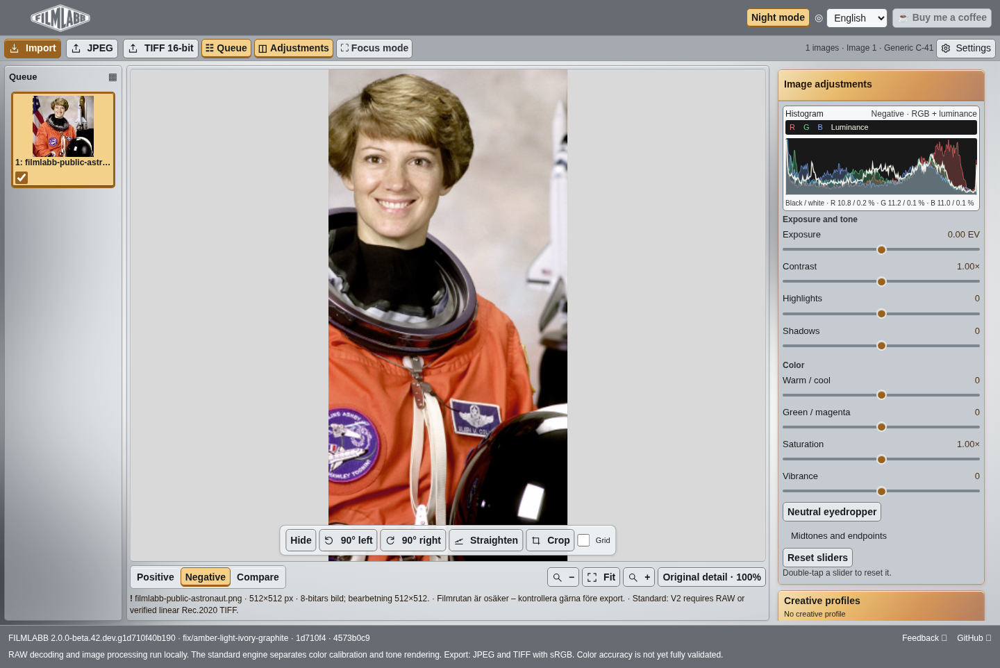
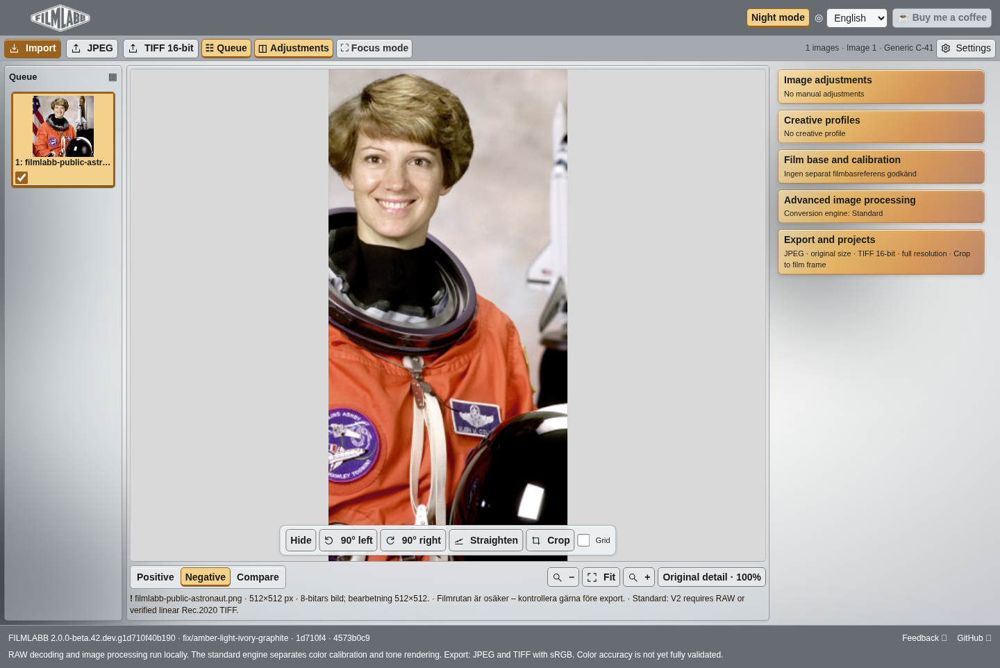
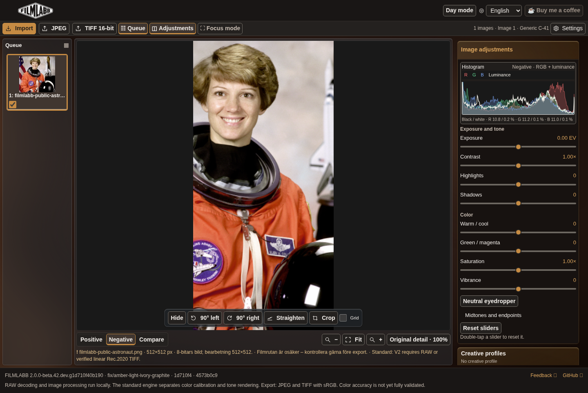
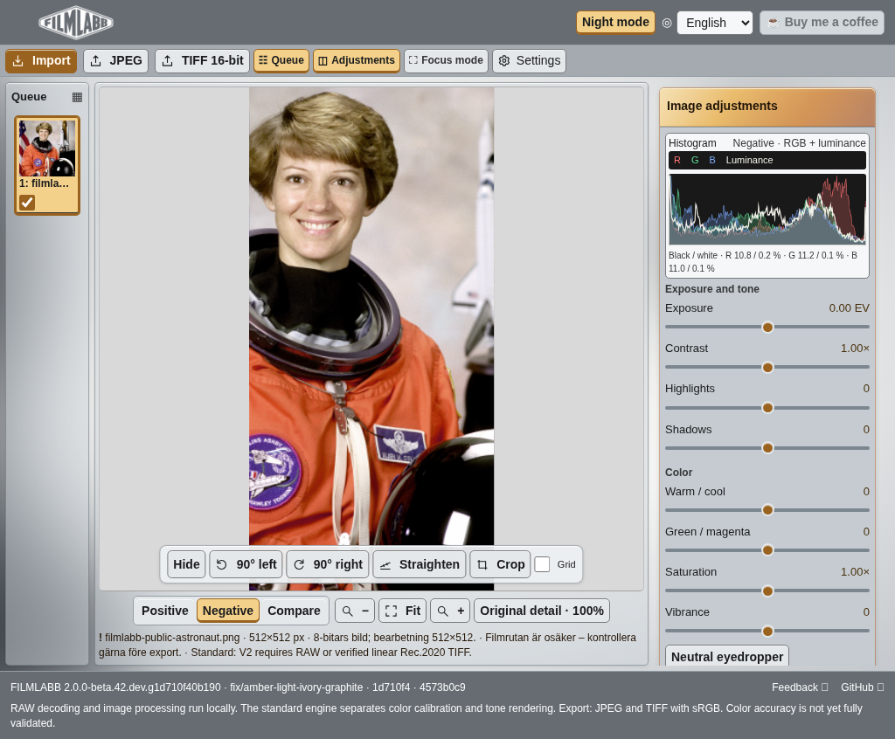
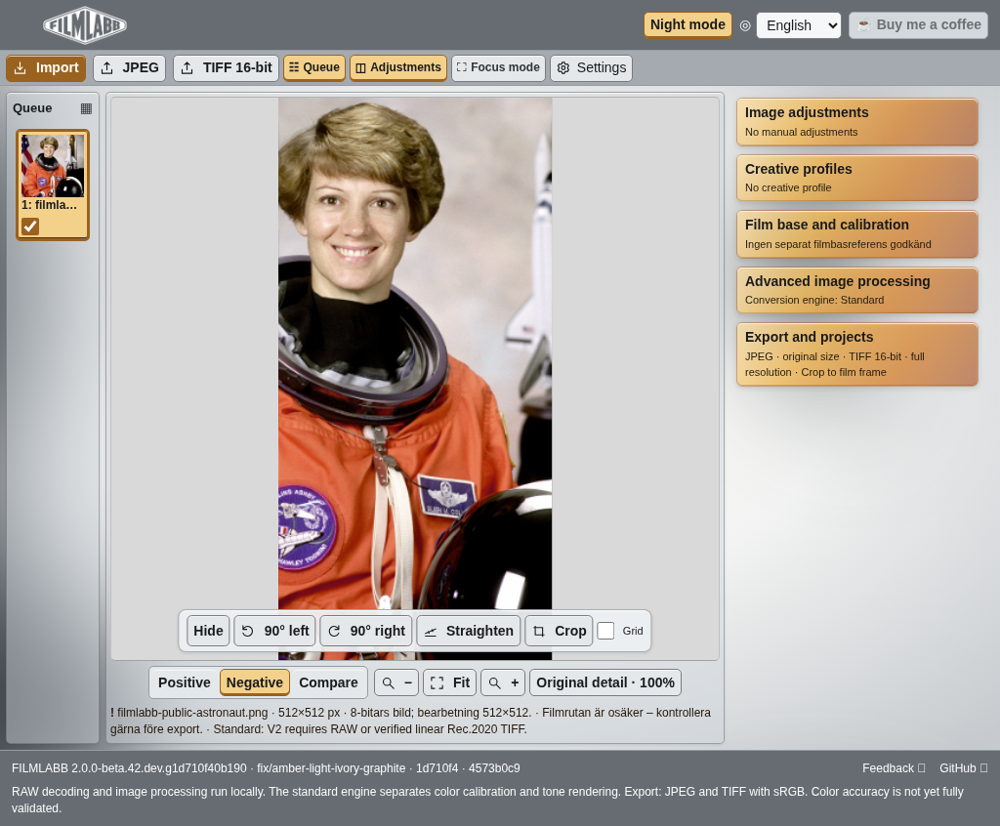
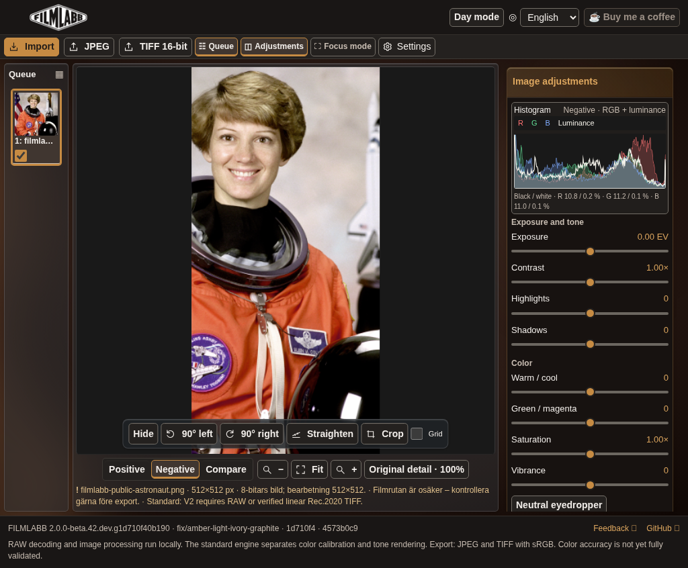

# FILMLABB review assets

Screenshots from the actual application for [PR #86](https://github.com/AxelTidehorn/negative-studio/pull/86), product commit `1d710f40b190e431039504394d5216f93c9c5df9`. This branch stores review images only; it contains no application or deployment code.

Viewports: desktop 1440×900 and touch-emulated iPad 1024×768. Full-page captures include the footer. Same public NASA Eileen Collins photograph (scikit-image data.astronaut), shown in source/negative view; no private photographs or RAW files. Physical iPad Safari is not verified.

## desktop

## ipad

