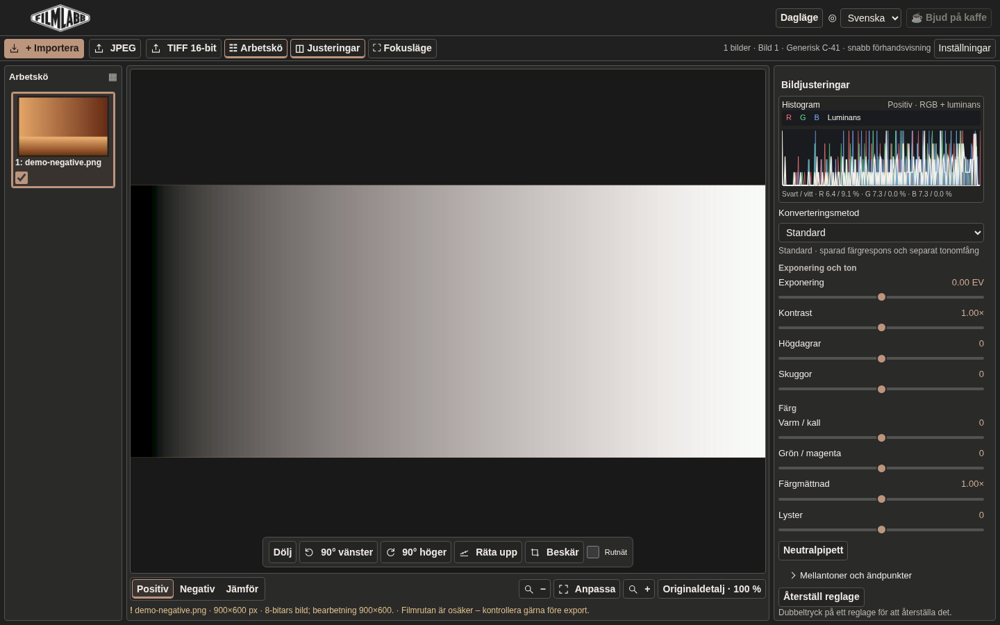
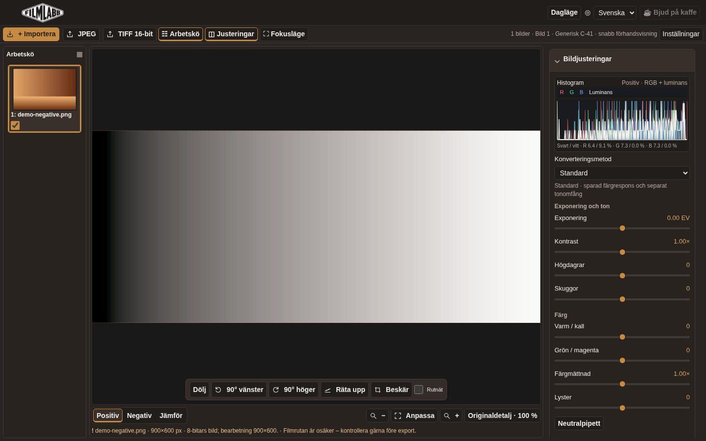
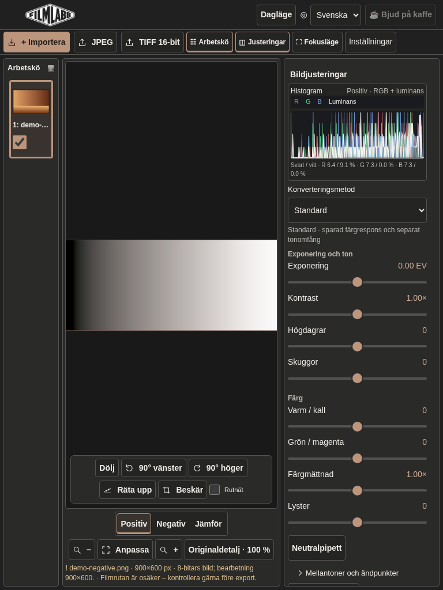
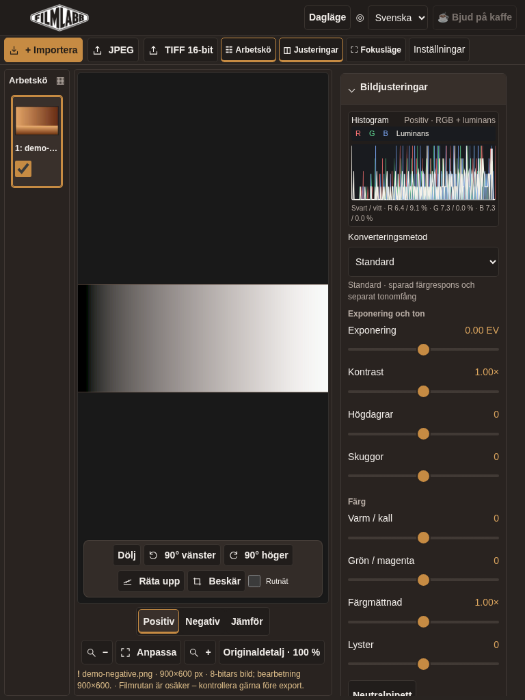
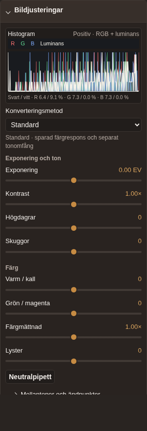
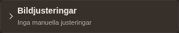

# UI 2.1 — floating cards and warm frosted surfaces

Based on main `1e6bc28` (merged GPU reconstruction PR #64). This is a presentation update; no image algorithms, shaders, render scheduling, geometry calculations, project schemas or export recipes change.

## Implementation

The existing five groups keep their order and control IDs: Image adjustments, Creative profiles, Film base/calibration, Advanced processing, Export/project. `workflow-ui.js` continues moving the original nodes and their existing handlers. Image adjustments and calibration now also use native `details`/`summary`; each card has one content wrapper. The main editor loses its shared background/frame, retaining its width and scroll behavior.

Native disclosures provide whole-row mouse/touch and keyboard operation. Only Image adjustments starts open. Main-card openness is session-only and is never reset by image/engine/profile/project changes. The former persistent Advanced-open preference is no longer read or written; no project data or new storage system is introduced. Existing nested frame/sample/geometry disclosures retain their tool-specific behavior.

Summaries read physical slider values, roll profile/strength/print, compatibility-filtered accepted film-base status, fine/quarter rotation and source corrections, and export size/crop. A candidate is never reported as accepted; V2's assumed base is explicitly unmeasured. Both export formats are stated because the application has two export actions, not a selected-format setting. Summaries reuse calibration UI refreshes, value synchronization and existing control events; they never request image analysis, rendering or GPU uploads. Five languages are supported. Long summaries wrap; full adjustment details remain in the summary tooltip.

## Material hierarchy

Palette tokens remain centralized in `ui-refinement.css`; Classic dark uses warm graphite, subdued amber and warm text. Other identities and all light palettes remain available.

- Closed cards and open headers: header color at 91%, 9px blur, 6px outer radius.
- Open bodies: **opaque** card color, opacity 1, no backdrop filter, reflection, gradient or shadow; one 10px padding layer.
- Header/footer: opaque flat chrome, no backdrop filter or shadow. Footer stays in document flow.
- Existing picture toolbar: 83% header color, 10px blur, 8px radius, original anchor and tool ownership.
- Histogram, sliders and numeric fields remain matte. RGB/luminance colors and calculations are unchanged.

`@supports` enables blur over a solid readable fallback. Reduced transparency removes blur/translucency; reduced motion disables card/toolbar animation; forced-colors uses system colors. No animated blur or large filtered content surface is introduced. Header targets remain at least 44px; existing touch controls are preserved.

## Reproduce visual verification

```sh
npm ci
npm run build
node tests/ui-21-browser.mjs
node tools/capture-ui-21.mjs after
npm run test:full
```

[`ui-2.1/before`](ui-2.1/before) contains real browser captures of clean main; [`ui-2.1/after`](ui-2.1/after) contains desktop, tablet landscape/portrait and phone captures, light/dark, the same card open/closed, the document footer, and the toolbar over light/dark synthetic image fields. The public `demo-negative.png` and generated uniform test fields are used, not private RAFs or AI mockups. Toolbar captures zoom the field to fill the viewport to inspect translucency.

| Before | After |
|---|---|
|  |  |
|  |  |

| Open card | Closed card |
|---|---|
|  |  |

See also [all cards closed](ui-2.1/after/desktop-closed.png), [light background toolbar](ui-2.1/after/toolbar-light.png) and [dark background toolbar](ui-2.1/after/toolbar-dark.png).

## Verification and limits

Verified locally on Node 24.22.1 / Chromium with SwiftShader: `npm run test:full` **116/116 groups passed** (374.81 seconds); the final `npm run build` passed. This includes existing pixel references, Editing 2.0/vibrance, RGB histogram, CPU/GPU, older projects, JPEG/TIFF, batch, cancellation and fallback regressions.

The targeted browser test checks initial defaults (including an obsolete saved Advanced-open preference), independent disclosures and keyboard focus, session retention across image/engine/project changes, editing/reset/profile/export summaries, film-base review/accept/undo, CPU/GPU switching, unique IDs, and material styles at four viewport sizes in both modes. It verifies that disclosures and language changes preserve image state, analysis counters and GPU reconstruction/upload counters. Material assertions require opaque bodies/chrome, 91%/9px headers, 83%/10px toolbar, and reduced-transparency fallback.

Existing workflows are updated to explicitly open the calibration card before measuring or interacting with its nested controls. Assertions of existing behavior remain; parent-ownership checks use the containing card through its single new body wrapper.

Release numbering is unchanged: main's immutable first-parent beta ordinal produces the next visible app version on merge; development builds show their actual SHA and dirty status. No manually predicted release is hardcoded into the UI.

Physical iPad Safari and Windows Edge are not available here. Chromium with touch emulation and SwiftShader verifies layout and flows, not device-specific glass compositing or physical GPU responsiveness. Native browser blur support may vary; unsupported browsers use the opaque fallback.
