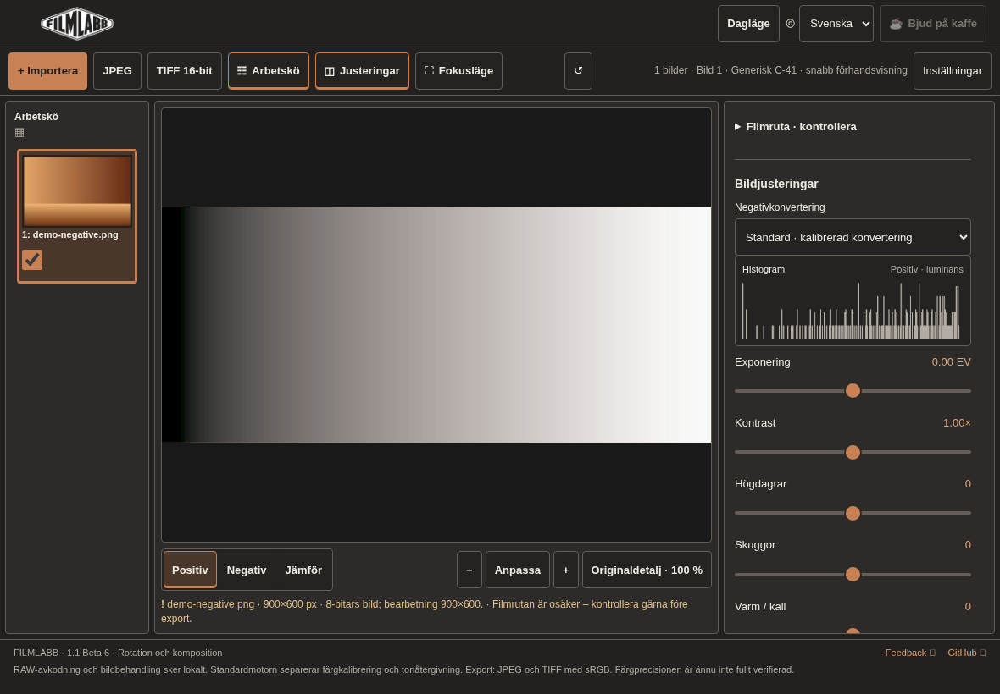
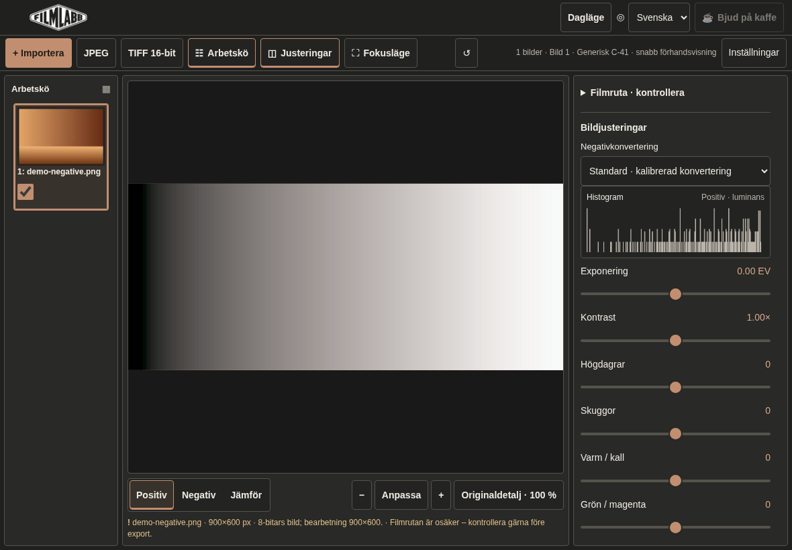

# Targeted UI stabilization

Baseline: main `6ff131a` after Conversion 3.0 / PR #29. This is a correction of
the existing interface, not the planned wider redesign. Existing navigation,
queue/preview/editor arrangement, all five conversion choices and Editing 2.0
remain. No conversion/editing formulas, import algorithms, geometry calculations,
export pixels, project schema or licensing files change.

## Reproduced problems and fixes

| Problem on frozen main | Cause and correction |
| --- | --- |
| Reset displayed neutral values with slider thumbs at the far left | Reset wrote physical data values directly into the 0–1000 presentation controls. It now uses the existing `syncControls` binding, also used by image/project restore. All 13 controls retain their existing asymmetric mapping and data defaults. |
| Black point .015 displayed as .01 | Output formatting always used two decimals. Labels now preserve the existing step precision (.005 and .025 require three). This only changes the label, not quantization or color math. |
| Footer stayed visible and reduced image/editor height | The footer was **not CSS-fixed**: workspace JavaScript subtracted its full height on every resize. General app/version information and Feedback/GitHub links now live in the existing Settings popup, next to Help. Workspace sizing no longer reserves footer height or observes it. Opening Settings does not shrink the editor. |
| Scrolled mobile sliders could sit under the photograph | The phone image panel was sticky above the page-scrolling editor. It now scrolls normally. The existing toolbar remains sticky; document scroll padding accounts for it when focusing or scrolling to a control. Entering frame/composition/straighten mode reveals the photograph so its existing handles remain usable. |
| Queue heading icon fell onto a separate line | The heading had block layout. A shared flex row now aligns the label and icon. |
| Fine-rotation output was not aligned with its label | The geometry CSS selected a first child that is actually a button row. It now selects the existing fine-rotation label explicitly. |
| Small labels and excessive empty section spacing | Labels increase to 13px desktop / 14px touch, summary text to 14px and histogram text to 12px. Closed sections no longer reserve empty body padding. Repeated control/section spacing and header/toolbar padding are adjusted separately. Touch controls keep 44px targets. |

Double click/double tap and the native profile/crop/rotation controls keep their
existing behavior. The binding regression covers data values, thumbs, displayed
precision, endpoints/inverses, queue restore and both editing versions. The UI's
previously centered neutral mapping stays intact; native sliders are not forced
onto that mapping. Reset still performs its existing technical reset/analysis;
ordinary theme/layout changes do not analyze or edit an image.

On desktop/tablet the editor has one vertical scrollbar; the queue remains an
independent scroller. There is no extra vertical document scrollbar. Phones use
normal vertical page scrolling plus the existing horizontal queue. The Settings
popup has its own bounded scroll area only while open. The existing single
scrollbar styling remains; no extra `!important` layer or custom touch scrollbar
is added. The workspace also honors a smaller `visualViewport.height` when the
browser reports it, without changing image geometry.

## Themes

All six identities, both modes, stored preferences and migration remain. Burgundy
**and every light palette retain their exact color values**. The other dark
palettes use more neutral surfaces and restrained accents. No identity is deleted
or automatically selected. Shared geometry/frame/photograph overlays are unchanged.

| Dark identity | Page / panel | Accent | Direction |
| --- | --- | --- | --- |
| Classic | `#20201f` / `#292927` | `#c18f70` | Warm graphite with quieter terracotta. |
| Olive | `#1d1f1b` / `#282b25` | `#abb395` | Neutral dark surfaces with olive emphasis. |
| Burgundy | `#21191c` / `#302429` | `#cc939b` | Existing palette, unchanged. |
| Industrial | `#1d1d1c` / `#292928` | `#c3bc87` | Neutral graphite, restrained pale accent. |
| Paper | `#211f1c` / `#2c2925` | `#a99a79` | Warm neutral rather than a strongly brown surface. |
| Aubergine | `#211f22` / `#2b282d` | `#aa97af` | Gray surfaces with a muted violet accent. |

The existing twelve-palette test verifies normal/muted/accent-label text at least
4.5:1, accent-button text at least 4.5:1 and focus at least 3:1. Appearance changes
preserve image pixels, calibration, project state and GPU uploads. These are
technical checks; aesthetic preferences remain a matter for user evaluation.

## Before / after

Same synthetic negative, automatic film frame, default workspace, Classic dark,
Chromium on Linux. Values below measure the **preview container**, not necessarily
the displayed photograph: fit still preserves the picture's aspect ratio and can
leave letterboxing. No zoom, sampling or color calculation was changed.

| Viewport | Before / after container height | Slider-label font |
| --- | --- | --- |
| Desktop 1440×900 | 633.20 → 707.20px (+74) | 12 → 13px |
| Short desktop 1280×600 | 333.20 → 407.20px (+74) | 12 → 13px |
| iPad-like landscape 1180×820, touch | 514.41 → 586.41px (+72) | 13 → 14px |
| iPad-like portrait 820×1180, touch | 808.41 → 896.41px (+88) | 13 → 14px |
| Phone 390×844, touch | 203.13 → 259.41px (+56.28) | 13 → 14px |

[Raw layout/reset observations](measurements/ui-stability-layout.json).

| iPad-like landscape: before | After |
| --- | --- |
|  |  |

Additional full-size pairs:
[desktop before](screenshots/ui-stability/desktop-before.png) /
[after](screenshots/ui-stability/desktop-after.png),
[portrait tablet before](screenshots/ui-stability/ipad-portrait-before.png) /
[after](screenshots/ui-stability/ipad-portrait-after.png),
[phone before](screenshots/ui-stability/mobile-before.png) /
[after](screenshots/ui-stability/mobile-after.png).

## Verification

Before application changes, the new Node regression failed with exposure thumb
0 instead of 500; the browser regression and measured viewport rectangles showed
the permanently reserved footer height. The original inspection also recorded
all 13 incorrect post-reset thumb positions and .015 displayed as .01. Existing
individual-reset behavior already worked and was preserved.

Focused Node/browser and existing UI/UX tests pass: actual reset actions, keyboard
endpoints, double tap, image switching, positive/negative/compare, histogram,
settings/footer access, 12 themes, five languages, mobile hit testing, touch targets
and unchanged pixels/calibration/geometry.

The first complete local run passed **62/63 groups** and caught a real mobile
composition regression after removing the sticky image: the existing touch test
could no longer reach an offscreen handle. The correction reveals the photograph
when entering the existing frame/composition/straighten modes; no coordinate or
sampling formula changes. Both the unchanged complete Beta 6 browser suite and
the strengthened UI suite then passed focused reruns. The final clean Node 22
Full run is enforced by the PR's GitHub CI; its result is recorded in the PR.
[Local verification history](measurements/ui-stability-verification.json) records
the initial failure explicitly rather than presenting it as a passing Full run.

Commands:

```sh
npm run test:fast
node tests/ui-controls.mjs
npm run build
FILMLABB_CHROMIUM_BIN=/path/to/chromium node tests/ui-stability-browser.mjs
FILMLABB_CHROMIUM_BIN=/path/to/chromium node tests/ui-ux-browser.mjs
npm run test:full
# Existing screenshot support; writes all 12 current theme/mode variants:
FILMLABB_UI_SCREENSHOTS=/tmp/filmlabb-ui npm run test:browser
```

The new binding test belongs to Fast and the existing numerical Integration;
Full additionally runs the targeted UI browser suite. This avoids running the
whole UI/language matrix after each conversion-engine change. No tests or frozen
pixel references were removed. There is no repository lint command/configuration;
changed JavaScript is checked with `node --check`, HTML IDs/label targets are
checked structurally, and the actual styles/layout are exercised in Chromium.

### Device limits and manual checklist

Chromium automation covers desktop, short desktop, tablet portrait/landscape,
phone, fine/coarse pointers, light/dark and five-language overflow. It is not a
physical iPad Safari or Microsoft Edge run. No Edge executable was found.
Playwright WebKit was downloaded but cannot launch because this host lacks GTK4,
Graphene, HarfBuzz-ICU, Manette, Hyphen and GLES libraries. This limitation is
reported rather than counted as a passing Safari test. No new app dependencies
were added.

On a real iPad Safari and Windows/Edge, verify:

- Portrait/landscape, browser bars and software keyboard: preview/editor remain
  usable, no extra vertical scrollbars or clipped controls.
- Scroll to every ordinary and expanded control; photograph/toolbar must not
  cover it. Check touch dragging and double tap, and mouse/keyboard focus in Edge.
- Global and individual reset: value, label and thumb agree; switch away/back.
- Positive/negative/compare, histogram, loading overlay and uncertainty warnings
  remain visible when relevant.
- Open Settings, reach footer/help/project links, change theme/mode/language and
  close it without changing workspace size or image settings.
- Import RAW/TIFF, switch all five engines, edit, crop/rotate, restore an older
  project and export JPEG/TIFF/batch. Existing automated checks supplement this
  photographic/device check; they do not replace it.
