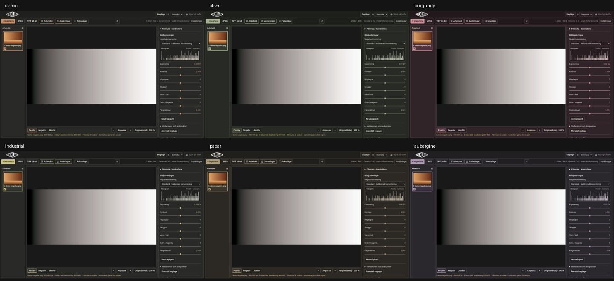
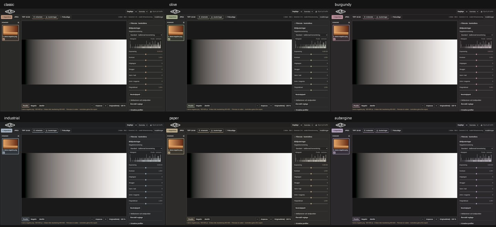

# FILMLABB UI/UX 2.0.2 – verifiering

Bas: `3e83c19569e486c9a20f96a269626168536ba340`, senaste origin/main vid fetch 2026-10-26. Ingen senare commit fanns på main. Korrigering av befintlig navigation och komponenter.

| Område | Utgångsläge | Ändring och bevis |
| --- | --- | --- |
| 1 Footer/scroll | Footern hade flyttats in i Inställningar. Workspace drog alltid av hela headerhöjden. | Ursprungligt innehåll/länkar från 5580f93 återställt i semantisk footer efter main. Endast synlig headerhöjd dras av; dokumentet scrollar, toolbar är sticky. Kö och editor har fortsatt avsiktlig intern scroll. Scrolltest visar 52 px extra bildhöjd när headern lämnar vyn. |
| 2 Paneler | Grid auto-placement placerade bilden i kolumn 1 när kön dolts; kolumnen hade bredd 0. | Alla fem direkta gridbarn har explicit kolumn/rad. Knappbindningar och befintlig lagringsnyckel bevarade. Alla fyra kombinationer kontrollerade vid 1440, 1024, 768 och 390 px. |
| 3 Densitet | Panelpadding, histogram/inställningsmarginaler och breda iPad-paneler tog bildyta. | Mindre padding/mellanrum, iPad-kolumner 96/270 i stället för 110/290, större mobilförhandsvisning. Samma textstorlekar och 44 px pekytor behållna. Se uppmätta dimensioner nedan. |
| 4 Alignment | Sektionspilar använde webbläsarens inline-marker, utan gemensam centrering mot text. | Gemensam flex-layout och CSS-chevron med align-items:center, för både öppna/stängda sektioner. Befintlig flex-layout för knapptext, rubriker och värden behållen. |
| 5 Återställning | Symbolknappen i toolbar återställde layout, medan reglageknappen även ersatte motorkonfiguration/kalibrering med defaults. | Textknappen Återställ layout ligger nu i Inställningar. Återställ reglage stannar i Bildjusteringar och återställer endast de 13 deklarerade bildreglagen. Kalibrering, motor, RAW-läge, beskärning och övrig konfiguration bevaras. |
| 6 Sliders | Tidigare korrigering hade centrerad 0–1000-bindning även för asymmetriska dataintervall. | Befintlig mappning/matematik oförändrad. Alla min/max/default, data/etikett/UI-position, individuell/global återställning och bildbyte testade. Projekt sparas med icke-neutrala värden och återimporteras via appens riktiga filflöde. Inaktiva äldre reglage testas via input-event, aktiva via native tangentbord/dubbelklick. |
| 7 Teman | Särskilt Burgundy, Olive och Paper färgade stora panelytor. Industrial hade gul accent. | Alla sex mörka paletter omarbetade med nära neutrala paneler. Återhållna accenter: varm Classic, oliv, vinröd, stålblå Industrial, pergament, aubergine. Bildomgivning samma neutrala grå. Ljusa paletter oförändrade. |
| 8 Bildprioritet | Panelbugg kunde helt dölja fotografiet. Liten mobilbild. | Gridfix, bredare bild på iPad, mindre bildpadding och större mobilbild. Fokusläge behåller visningsknappar, zoom och status. Histogrammet ligger fortsatt i Bildjusteringar. Import/export/laddningsindikatorer och övriga funktioner kvar. |
| 9 Publicering/cache | Befintligt bygge hashar hela site-trädet och precachar komplett version; ingen cachebugg påvisad. | Ingen cachekod ändrad. Publicerade UI-filer matchar main, se published-baseline.json. Cache-ID matchar lokalt basbygge. Befintliga tema/layoutnycklar och projektschema behållna. Ny PR-version är inte publicerad. |
| 10 Visuell QA | Tidigare tester krävde uttryckligen footer i popup och ingen dokumentscroll. | Dessa förväntningar korrigerade. Före/efter i fyra viewportar och sex mörka teman, samt fokus/scroll/footer. Befintlig Playwright-harness återanvänds. Begränsningar nedan innebär att uppdragets hela enhetsacceptans ännu inte är uppfylld. |

## Bilder och visuell bedömning

Alla bilder använder samma medföljande `demo-negative.png` (syntetiskt testnegativ), Chromium på Linux, svensk locale, samma viewport och simulerad touch på iPad/mobil. Inga bilder av privata användarprojekt används. Detta är inte en bedömning med verkliga fotografier eller fysisk skärm.

| Viewport | Före | Efter | Bildyta före → efter (CSS px, header synlig) |
| --- | --- | --- | --- |
| Desktop 1440×900 | [bild](before/desktop.png) | [bild](after/desktop.png) | 908×705 → 914×715 |
| iPad landskap 1024×768 | [bild](before/ipad-landscape.png) | [bild](after/ipad-landscape.png) | 582×532 → 622×542 |
| iPad porträtt 768×1024 | [bild](before/ipad-portrait.png) | [bild](after/ipad-portrait.png) | 326×722 → 366×748 |
| Mobil 390×844 | [bild](before/mobile.png) | [bild](after/mobile.png) | 362×257 → 362×329 |

[Fokusläge med bortscrollad header](after/focus-scrolled.png) · [Återställd footer](after/footer.png).

Visuellt granskade originalbilder för desktop, båda iPad-orienteringarna och mobil, samt jämförelsebilder för alla teman. Desktopförbättringen är liten med båda paneler framme; större vinsten är korrekt expansion vid dolda paneler och frigjord headerhöjd. iPad får påtagligt bredare bild utan att reglagetext krymps. Mobil får högre förhandsvisning och längre dokumentscroll. Porträtt med båda paneler är fortfarande trångt; panelknapparna och fokusläget behövs för stor bild. Histogrammet och värdena är läsbara. Chevron och rubrik följer samma centrum. De mörka paletterna ger nu grå paneler, medan markerad bild, reglage, länkar och aktiva knappar bär temafärgen. Inga stora färgade arbetsytor kvar.

### Sex mörka teman

Före:

Efter:

Originalstorlek: [Classic](after/classic.png), [Olive](after/olive.png), [Burgundy](after/burgundy.png), [Industrial](after/industrial.png), [Paper](after/paper.png), [Aubergine](after/aubergine.png).

## Kvarstående verifiering och cachebegränsning

- Ingen fysisk iPad Safari eller Windows Edge testad. Chromium på Linux med viewport/touch-emulering ersätter inte dessa kontroller. WebKit-installation försöktes men kan inte starta utan saknade GTK/Graphene/Harfbuzz/Manette/Hyphen/GLES-bibliotek; systeminstallation krävde otillgänglig rootåtkomst.
- Ny version ska kontrolleras på publicerad URL efter merge/deploy. Denna PR mergear eller publicerar inte automatiskt.
- En ny service worker väntar medan den tidigare versionens flikar fortfarande är öppna. Alla FILMLABB-flikar kan behöva stängas och appen öppnas igen; en vanlig omladdning räcker inte alltid. Detta bevarar sammanhängande filer för redan öppna sessioner. Spara projekt först: importerade originalbilder finns endast i den öppna sessionen och måste återimporteras. Ingen cache- eller användardatarensning införs.
- GitHub Pages har `max-age=600` på HTTP-svar. Installationens `cache:reload` och `updateViaCache:none` undviker HTTP-cachen för nya kompletta offlineversioner. CDN/publicering kan ändå ta tid; inga ogrundade ändringar i fungerande cachekod har gjorts.

Reproducera bildinsamling efter `npm ci` och `npm run build`: `node tools/capture-ui-202.mjs after`. För före-bilder krävs bascommitens build. Testresultat sammanfattas i PR-beskrivningen.
