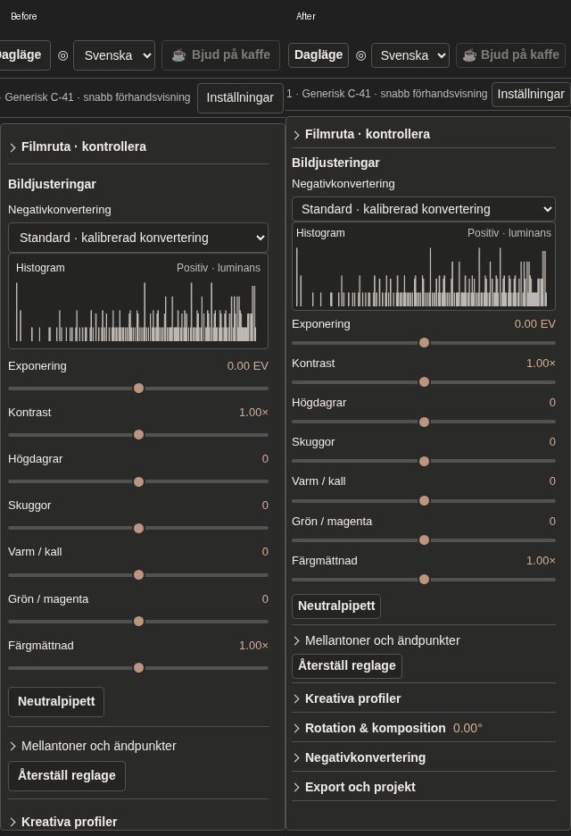

# Tätare knappar och högerspalt

Uppföljning efter mergad PR #31, bas `d23dc7f`.

- Knappar: padding 6×10 → 3×6 px, höjd 34 → 28 px med mus och 44 → 36 px på pekskärm. Även symbolknappar får minst samma bredd som höjd.
- Högerspalt: padding 8 → 6 px, på mobil 10 → 6 px. Mindre sektionsmarginaler, rubrikpadding och avstånd mellan label och slider. Färre staplade mellanrum kring histogram och expanderbara sektioner.
- Oförändrad textstorlek: 13 px för reglagelabels med mus, 14 px på pekskärm. Histogrammets bildhöjd är fortsatt 68 px. Sliderknoppar och värdemappning oförändrade.

| Mätning | Före | Efter |
| --- | --- | --- |
| Bildjusteringarnas totala höjd, desktop | 705 px | 595 px |
| Bildjusteringarnas totala höjd, simulerad iPad/mobil | 869 px | 709 px |
| Primära bildreglage, desktop | 361 px | 307 px |
| Primära bildreglage, simulerad iPad/mobil | 483 px | 389 px |

Hela vyer: [desktop före](padding-before/desktop.png) / [efter](padding-after/desktop.png), [iPad landskap före](padding-before/ipad-landscape.png) / [efter](padding-after/ipad-landscape.png), [iPad porträtt före](padding-before/ipad-portrait.png) / [efter](padding-after/ipad-portrait.png), [mobil före](padding-before/mobile.png) / [efter](padding-after/mobile.png).

Visuellt granskade i Chromium på Linux, med simulerad touch på iPad/mobil och samma testnegativ. På desktop ryms nu även Rotation, Negativkonvertering och Export/projekt utan att rulla högerspalten. På iPad-porträtt ryms samtliga primära reglage och de stängda sekundära sektionerna. Ingen fysisk enhet har testats.

Verifiering: `test:fast` (6/6), `ui-stability-browser.mjs`, `ui-ux-browser.mjs` och `ui-202-browser.mjs`. Befintliga pekmålsassertioner uppdaterade till den avsiktliga 36 px-storleken. Bygge och `git diff --check` kontrollerade. Ingen full testsvit återkörd för denna CSS-korrigering.
