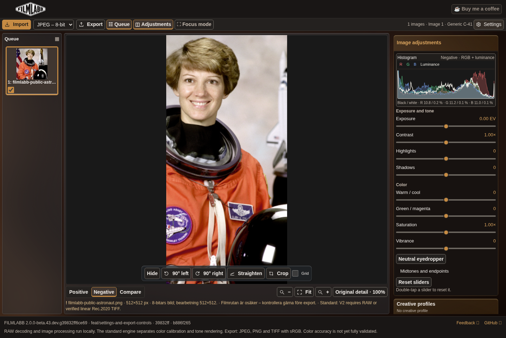
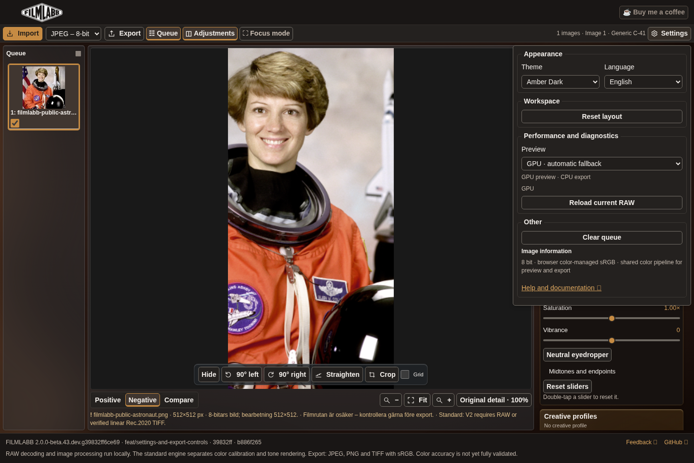
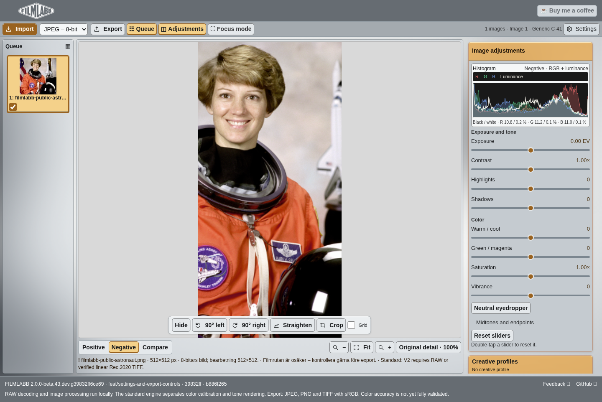
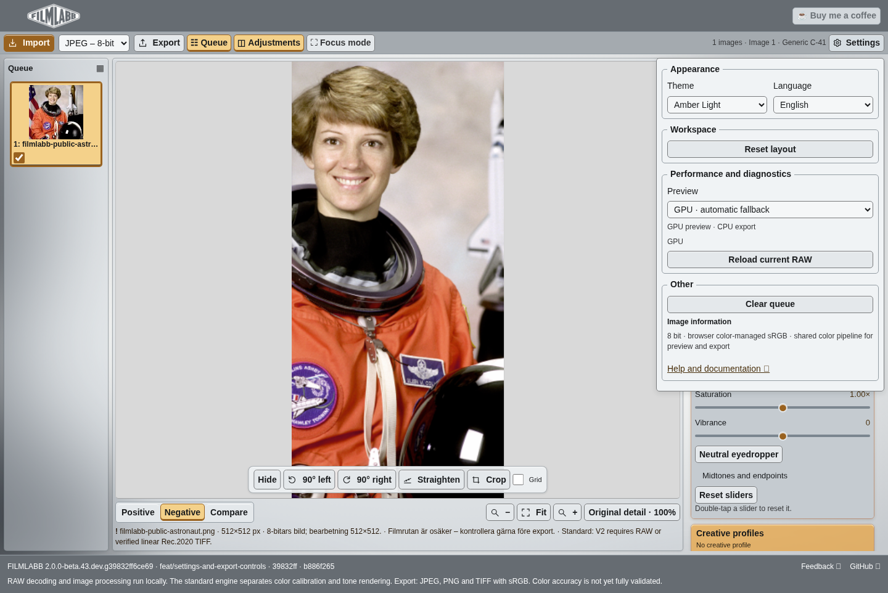
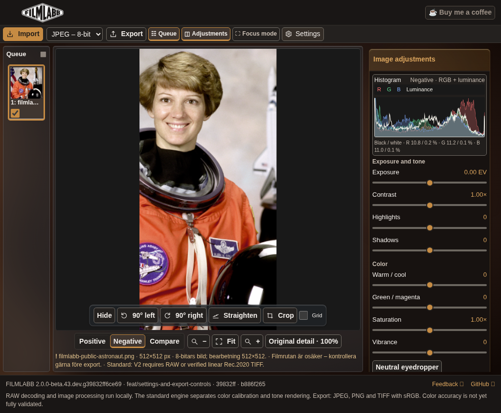
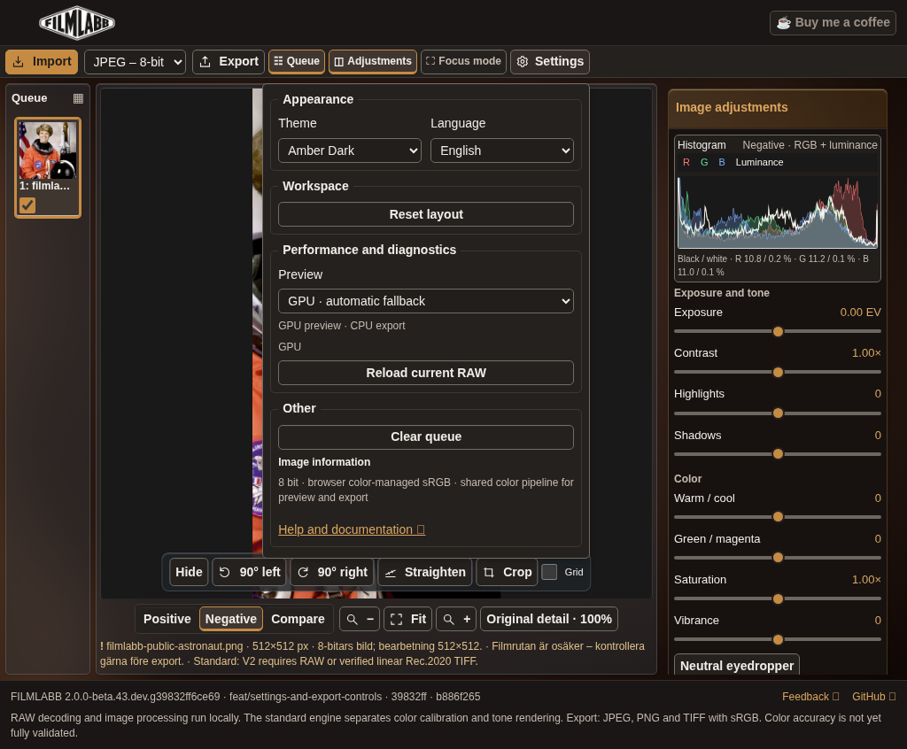
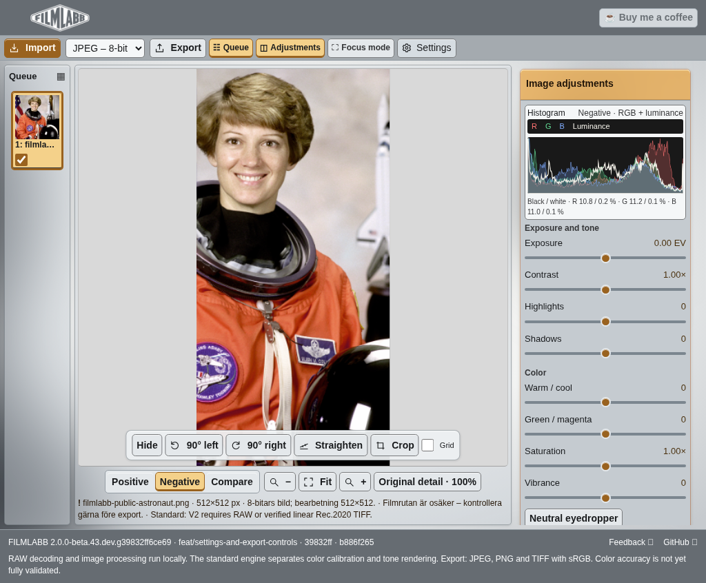
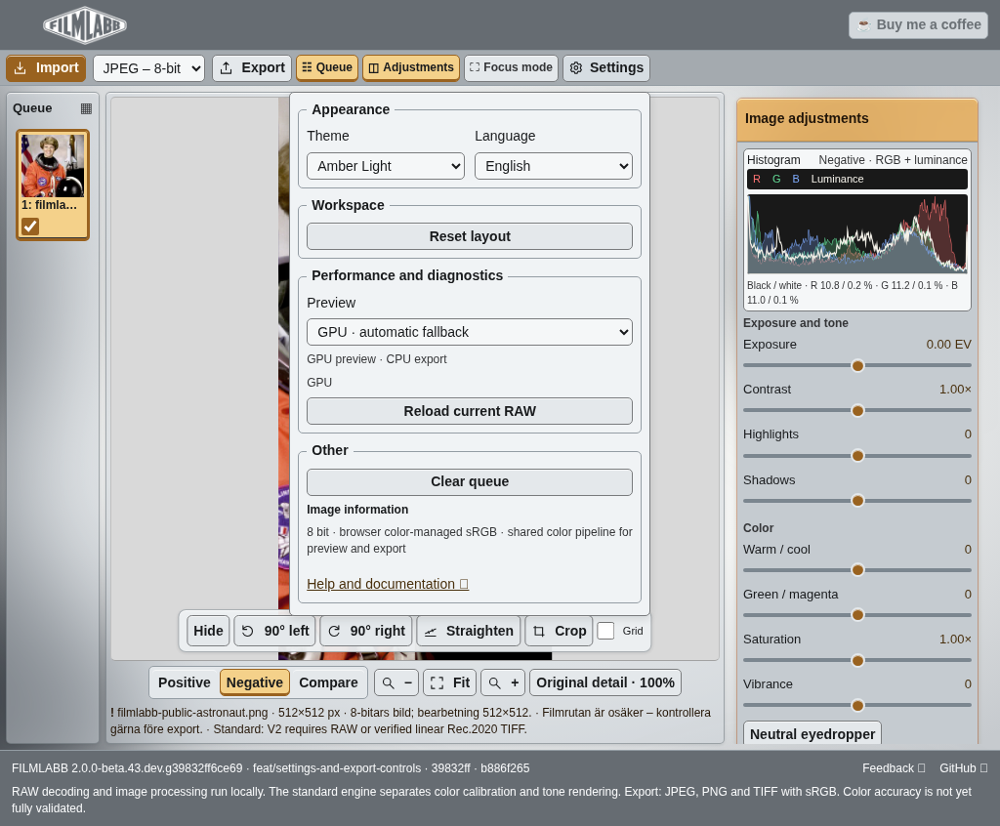

# Settings and export review – PR #88

Product commit `39832ff6ce694dc9915816ca021885de5968bb54`. Viewports: desktop 1440×900, touch-emulated iPad 1024×768; full-page captures include the footer. Same public NASA Eileen Collins photograph (scikit-image data.astronaut), shown in source/negative view. PNG16 precision samples use repository synthetic-negative.dng, not a private photograph.

125/125 local test groups pass. PNG16 has true 16-bit RGB channels with low bits preserved; samples equal TIFF16 exactly. See export-proof.json and downloadable precision files. No merge or app deployment.
